# Rapport de l'Activité Pratique N°2 - Architecture Micro-services avec Spring cloud

**Référence :** [ [Video 01](https://www.youtube.com/watch?v=kOVHzN8I8e8) , 
                [Video 02](https://www.youtube.com/watch?v=kOVHzN8I8e8) , 
                [Video 03](https://www.youtube.com/watch?v=-G2rcLMO1gQ) ] \
**Réalisé par :** HAMZA ELCADI - GLSID3

---

## 1 - Création du projet

On Créer un projet java `ecom-ms-app` :

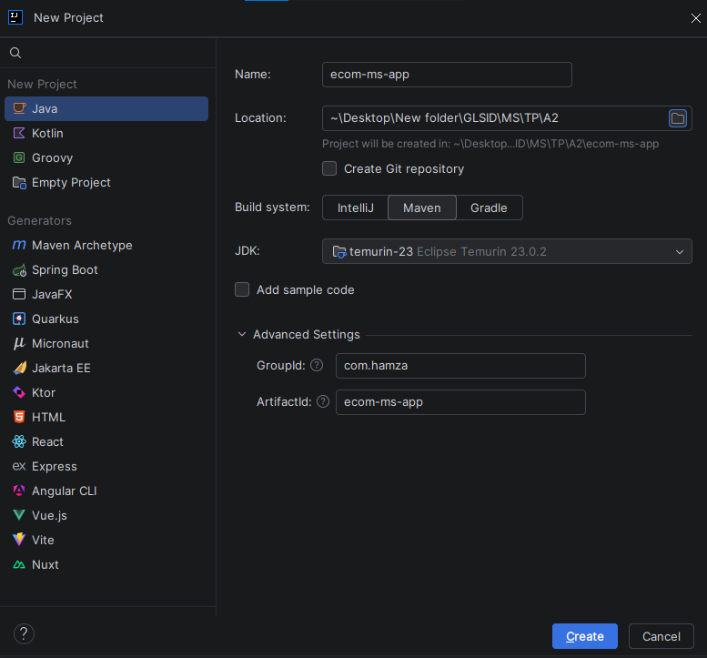
## 2 - Création de micro-service customer-service qui permet de gérer les client
On Créer le micro service `customer-service` : \
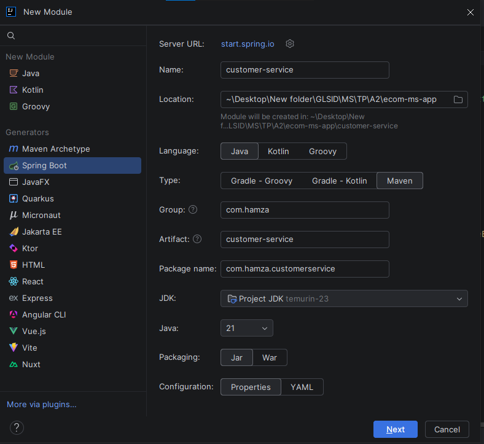 \

Avec les dépendances suivantes :
- **Spring Web**
- **Spring Data JPA**
- **H2 Database**
- **Lombok**
- **Rest Repository**
- **Eureka Discovery Client**
- **Config Client**
- **Spring Boot Actuator** //pour le monitoring du micro service \

apres la creation de entitie `Customer` et repository `CustomerRepository`, et la configuration de `application.properties` avec numero de port `8081` et l'ajoute des clients dans `CustomerServiceApplication` utilisons le `CommandeLineRunner`. \
on tester 

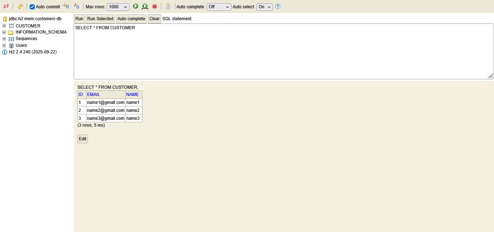
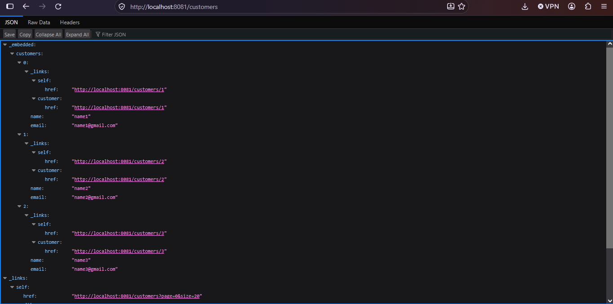

## 3 - Création de micro-service inventory-service qui permet de gérer les produits
On Créer le micro service `inventory-service` : \
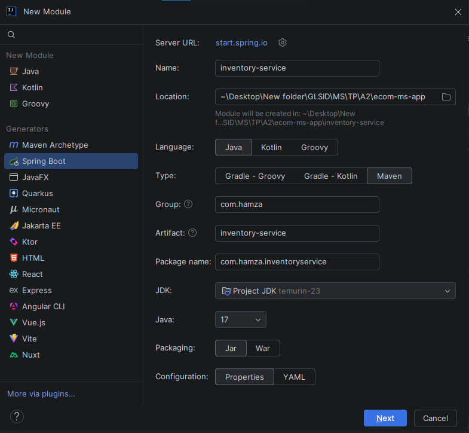 \

Avec les dépendances suivantes :
- **Spring Web**
- **Spring Data JPA**
- **H2 Database**
- **Lombok**
- **Rest Repository**
- **Eureka Discovery Client**
- **Config Client**
- **Spring Boot Actuator** //pour le monitoring du micro service \

apres la creation de entitie `Product` et repository `ProductRepository`, et la configuration de `application.properties` avec numero de port `8082` et l'ajoute des clients dans `InventoryServiceApplication` utilisons le `CommandeLineRunner`. \
on tester

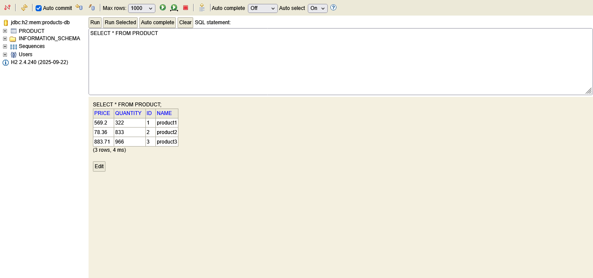
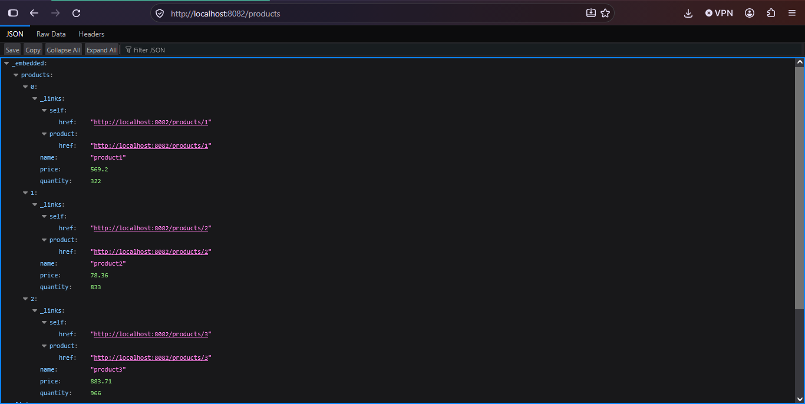
```text
Note : il faut desactiver spring cloud discovery et spring cloud config dans application.properties de deux micro service, car on n'a pas encore
creer discovery service et configration service.
spring.cloud.discovery.enabled=false
spring.cloud.config.enabled=false
```
pour verifier le status de micro service on utilise `actuator`, on entrer `/actuator/health`.
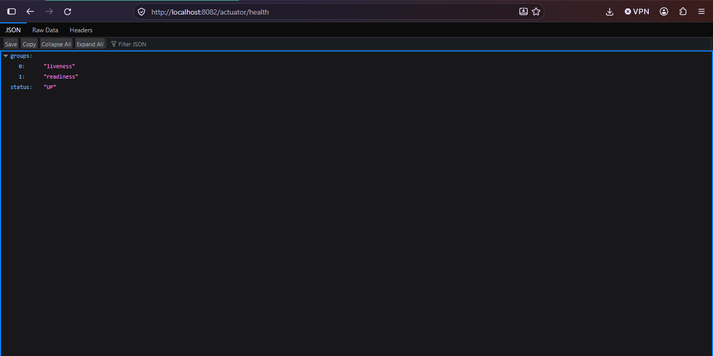 \
et pour voir tous les options de actuator on visite `/actuator`
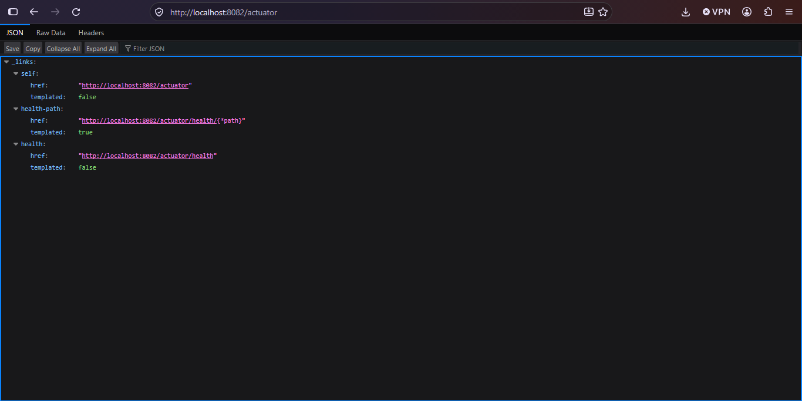 \
pour avoir tous les options possible on ajoute dans `application.properties`
```text
management.endpoints.web.exposure.include=*
```
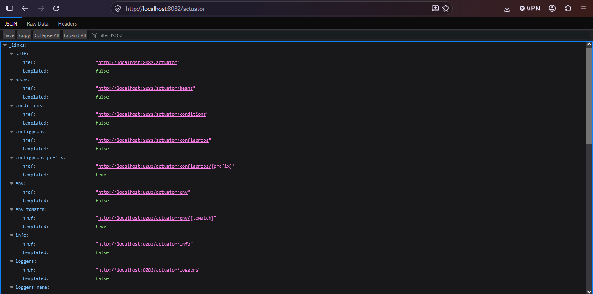

# 4 - Création de Gateway Spring cloud Gateway
On Créer le gateway `gateway-service` : \
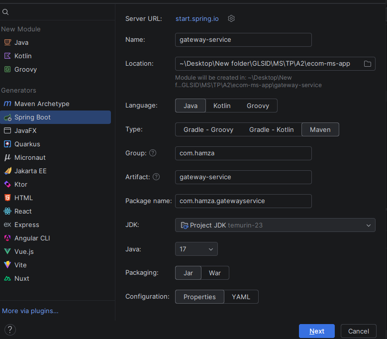 \

Avec les dépendances suivantes :
- **Reactive Gateway**
- **Eureka Discovery Client**
- **Spring Boot Actuator** //pour le monitoring du micro service \

il y' a deux methodes de creer le gateway : 
- **static** : on creer un fichier `application.yaml`
```yaml
spring:
  cloud:
    gateway:
      server:
        webflux:
          routes:
            - id : r1
              #              uri : http://localhost:8081
              uri : lb://CUSTOMER-SERVICE
              predicates:
                - Path= /customers/**
            - id : r2
              #              uri : http://localhost:8082
              uri : lb://INVENTORY-SERVICE
              predicates:
                - Path= /products/** 
```
ou configurer directement dans `application.properties`
```text
spring.cloud.gateway.server.webflux.routes[0].id=r1
spring.cloud.gateway.server.webflux.routes[0].uri=lb://CUSTOMER-SERVICE
spring.cloud.gateway.server.webflux.routes[0].name=Path
spring.cloud.gateway.server.webflux.routes[0].Path=/customers/**
```
ou dans `GatewayServiceApplication`
```java
@Bean
public RouteBuilder routes (RouteLocatorBuilder builder) {
	return builder.routes()
			.route("r1", predicates -> predicates.path("/customers/**").uri("lb://CUSTOMER-SERVICE")
			.route("r2", predicates -> predicates.path("/products/**").uri("lb://INVENTORY-SERVICE")
			.build();
}
```
et on le tester :
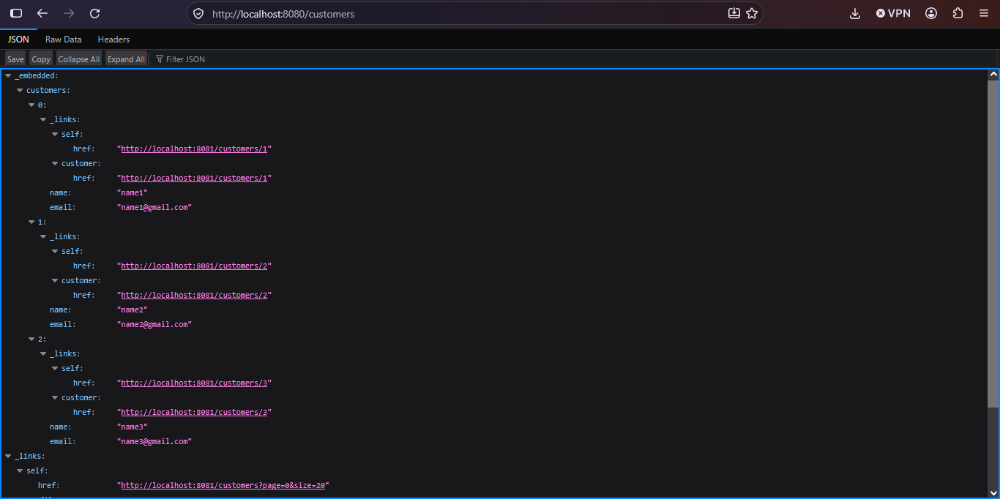


- **dynamic :** dans `GatewayServiceApplication`
```java
@Bean
DiscoveryCLientRouteDefinitionLocator dynamicRoutes(ReactiveDiscoveryClient rdc,
DiscoveryLocatorProperties dlp){
	return new DiscoveryClientRouteDefinitionLocator(rdc,dlp);
}
```
## 5 - Création de l'annuaire Eureka Discrovery Service
On Créer `discovery-service` : \
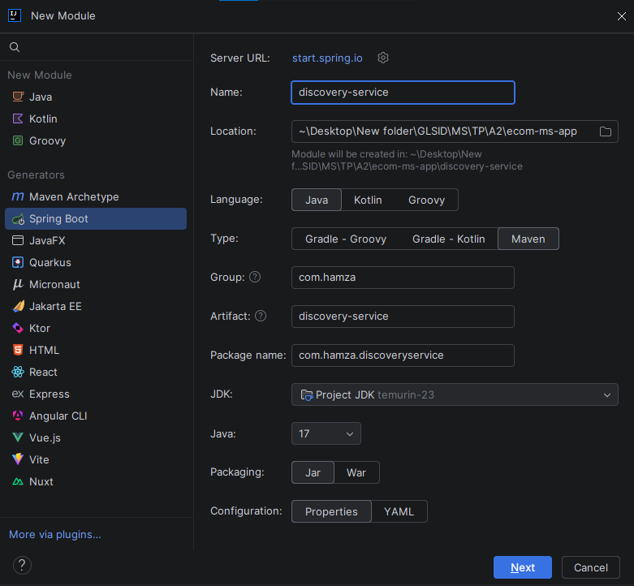 \

Avec les dépendances suivantes :
- **Eureka Server**
- **Spring Boot Actuator** //pour le monitoring du micro service \

apres on ajoutons l'annotation dans `DiscoveryServiceApplication`
```java
@EnableEurekaServer
```
et avec la configuration
```text
spring.application.name=discovery-service
server.port=8761
eureka.client.fetch-registry=false
eureka.client.register-with-eureka=false
```
et activer spring cloud discovery de tous les autre micro service (customer, inventory, et gateway)
```text
spring.cloud.discovery.enabled=true
```
on le test 
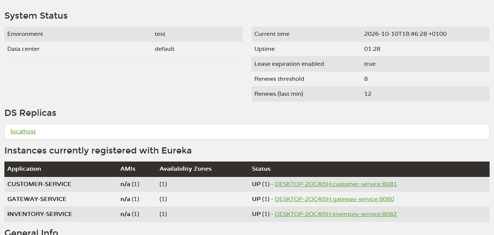
et on teste le gateway dynamique :
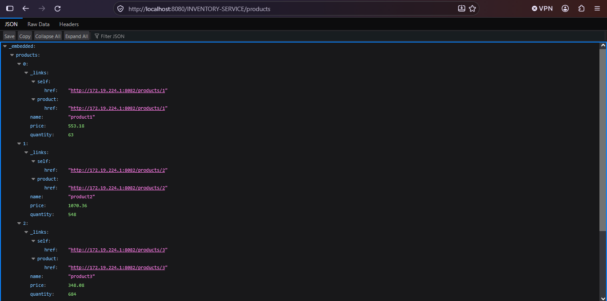
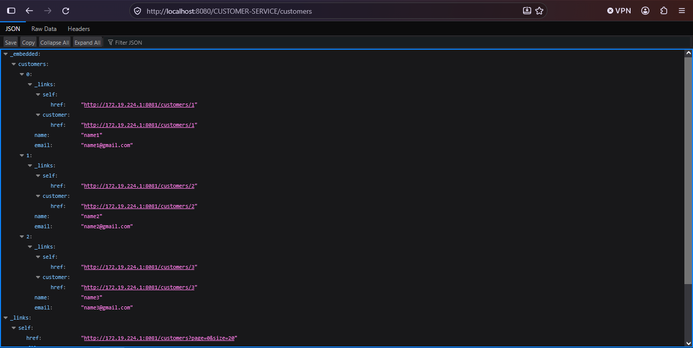
```text
NOTE : il faut ajouter dans application.properties de les deux micro service inventory-service
et customer-service :
eureka.instance.prefer-ip-address=true
pour ils fonctions avec gateway dynamique.
```
