# Rapport de l'Activité Pratique N°3 - Event Driven Architecture - Classroom

**Référence :** https://www.youtube.com/watch?v=8uY7JE_X_Fw \
**Réalisé par :** HAMZA ELCADI - GLSID3

---

## 1 - Création du projet

On crée un projet Java `kafka-spring-cloud-stream` :

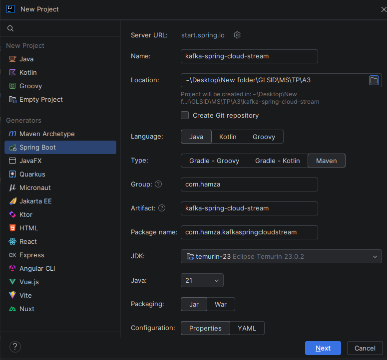

Avec les dépendances suivantes :
- **Spring Web**
- **Lombok**
- **Spring for Apache Kafka**
- **Spring for Apache Kafka Streams**
- **Cloud Stream** \
## 2 - Utilisation de Kafka et Zookeeper
Tout d'abord, on installe `Apache Kafka` : \
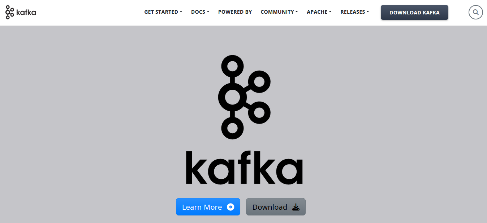
Puis on installe `Apache Zookeeper` : \
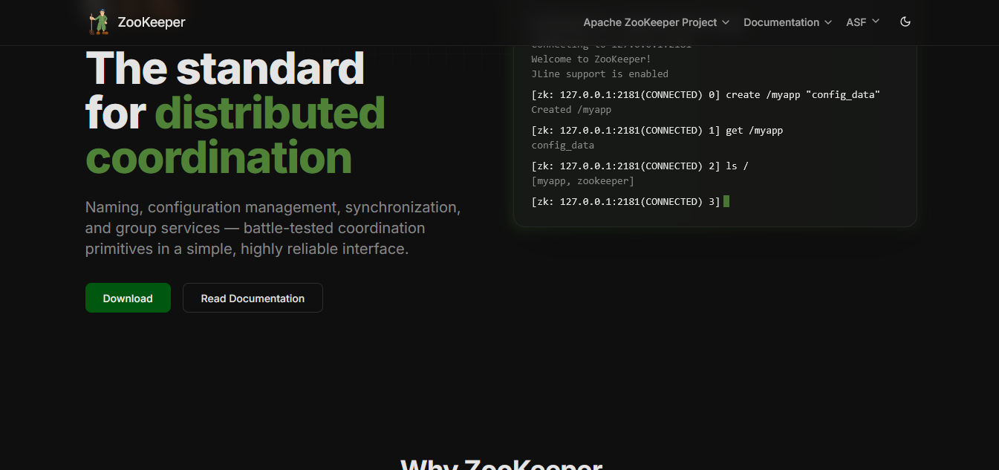 \

Puis on exécute les commandes suivantes : \
```shell
 bin\windows\zookeeper-server-start.bat config/zookeeper.properties
 bin\windows\kafka-server-start.bat config/server.properties
```
Puis on lance le producer et le consumer Kafka :
```shell
bin\windows\kafka-console-consumer.bat --bootstrap-server localhost:9092 --topic T1 --property print.key=true --property print.value=true --property key.deserializer=org.apache.kafka.common.serialization.StringDeserializer --property value.deserializer=org.apache.kafka.common.serialization.StringDeserializer
bin\windows\kafka-console-producer.bat --broker-list localhost:9092 --topic T1
```
## 3 - Utilisation de Docker
On crée un fichier `compose.yml` à la racine du projet. \
```yaml
version: '3'
services:
  zookeeper:
    image: confluentinc/cp-zookeeper:7.3.0
    container_name: glsid-zookeeper
    environment:
      ZOOKEEPER_CLIENT_PORT: 2181
      ZOOKEEPER_TICK_TIME: 2000

  broker:
    image: confluentinc/cp-kafka:7.3.0
    container_name: glsid-kafka-broker
    ports:
      # To learn about configuring Kafka for access across networks see
      # https://www.confluent.io/blog/kafka-client-cannot-connect-to-broker-on-aws-on-docker-etc/
      - "9092:9092"
    depends_on:
      - zookeeper
    environment:
      KAFKA_BROKER_ID: 1
      KAFKA_ZOOKEEPER_CONNECT: 'zookeeper:2181'
      KAFKA_LISTENER_SECURITY_PROTOCOL_MAP: PLAINTEXT:PLAINTEXT,PLAINTEXT_INTERNAL:PLAINTEXT
      KAFKA_ADVERTISED_LISTENERS: PLAINTEXT://localhost:9092,PLAINTEXT_INTERNAL://broker:29092
      KAFKA_OFFSETS_TOPIC_REPLICATION_FACTOR: 1
      KAFKA_TRANSACTION_STATE_LOG_MIN_ISR: 1
      KAFKA_TRANSACTION_STATE_LOG_REPLICATION_FACTOR: 1
```
Puis on démarre Docker :
```shell
docker compose up
```
Puis :
```shell
docker exec --interactive --tty glsid-kafka-broker kafka-console-consumer --bootstrap-server broker:9092 --topic T1
docker exec --interactive --tty glsid-kafka-broker kafka-console-producer --bootstrap-server broker:9092 --topic T1
```
On le teste :
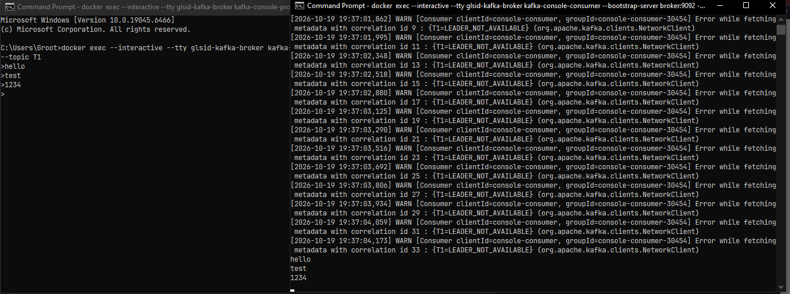

## 4 - Un service Producer Kafka via un Rest Controller
On crée un record `events.PageEvent` :
```java
public record PageEvent(String name, String user, Date date, long duration ) {
}
```
Et une classe `controllers.PageEventController` :
```java
@RestController
public class PageEventController {
    @Autowired
    private StreamBridge streamBridge;
    @Autowired
    private InteractiveQueryService interactiveQueryService;
    @GetMapping("/publish")
    public PageEvent publish(String name, String topic){
        PageEvent event= new PageEvent(
                name,
                Math.random()>0.5?"U1":"U2",
                new Date(),10+new Random().nextInt(10000));
        streamBridge.send(topic, event);
        return event;
    }
}
```
Puis on configure le port dans `application.properties` :
```properties
server.port=8080
```
Et on le teste :
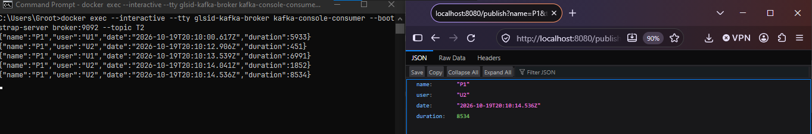 \

## 5 - Un service Consumer Kafka
On crée notre propre consumer Kafka basé sur Spring. Pour cela : \
on crée `handlers.PageEventHandler`, un composant Spring qui contient un `bean` permettant
de retourner un objet `Consumer`.
```java
@Component
public class PageEventHandler {

    @Bean
    public Consumer<PageEvent> pageEventConsumer(){
        return (input) -> {
            System.out.println("*******************");
            System.out.println(input.toString());
            System.out.println("*****************");
        };
    }
}
```
`input` est de type `PageEvent`. C'est-à-dire que nous avons créé un consumer qui sera instancié au début
de l'exécution de l'application, et qui s'abonnera à un `topic` que l'on spécifie
dans `application.properties` :
```properties
spring.cloud.stream.bindings.pageEventConsumer-in-0.destination=T2
spring.cloud.function.definition=pageEventConsumer
```
On le teste :
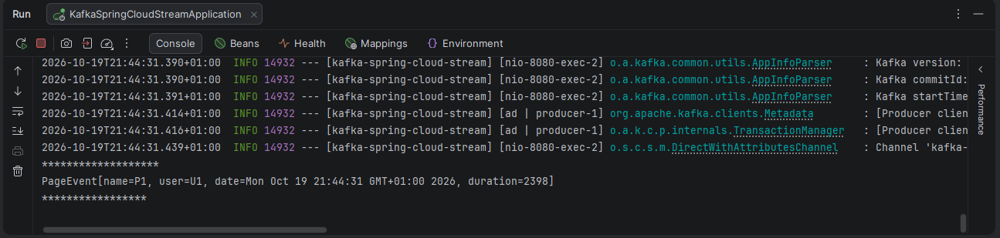 \


## 6 - Un service Supplier Kafka
Pour créer un supplier, il suffit de créer une fonction qui retourne un objet de type `Supplier`,
dans `PageEventHandler` :
```java
@Bean
public Supplier<PageEvent> pageEventSupplier(){
    return ()->{
        return new PageEvent(
                Math.random()>0.5?"P1":"P2",
                Math.random()>0.5?"U1":"U2",
                new Date(),
                10+new Random().nextInt(10000)
        );
    };
}
```
Puis on déclare le topic du supplier dans `application.properties` :
```properties
spring.cloud.stream.bindings.pageEventSupplier-out-0.destination=T3
spring.cloud.function.definition=pageEventConsumer;pageEventSupplier
```
On le teste : \
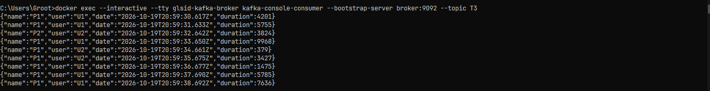 \
La durée par défaut entre deux messages est de `1 seconde`, mais on peut la modifier avec la propriété suivante :
```properties
spring.cloud.stream.bindings.pageEventSupplier-out-0.producer.poller.fixed-delay=200
```
Cette fonctionnalité est utile pour simuler un flux de données (stream).

## 7 - Un service de Data Analytics en temps réel (Stream Processing) avec Kafka Streams
Pour créer un service de data analytics en temps réel, on ajoute une fonction
`Function` qui a une entrée et une sortie dans `PageEventHandler` :
```java
@Bean
public Function<KStream<String, PageEvent>, KStream<String, Long>> kStreamFunction() {
    return (input) ->
            input.filter((k,v)->v.duration()>100)
                    .map((k,v)->new KeyValue<>(v.name(), v.duration())); // mapping: the old key-value becomes a new key-value where the key is the name of the PageEvent and the value is its duration
    // the filter keeps only the events with duration > 100
}
```
Puis on ajoute la déclaration dans `application.properties` :
```properties
spring.cloud.stream.bindings.kStreamFunction-in-0.destination=T3
spring.cloud.stream.bindings.kStreamFunction-out-0.destination=T4
```
On le teste avec un supplier dans T3 et un consumer dans T4, avec les commandes suivantes :
```shell
# supplier
docker exec --interactive --tty glsid-kafka-broker kafka-console-consumer --bootstrap-server broker:9092 --topic T3
# consumer
docker exec --interactive --tty glsid-kafka-broker kafka-console-consumer --bootstrap-server broker:9092 --topic T4 --property print.key=true --property print.value=true --property key.deserializer=org.apache.kafka.common.serialization.StringDeserializer --property value.deserializer=org.apache.kafka.common.serialization.LongDeserializer
```
La raison pour laquelle on n'utilise pas la commande suivante :
```shell
docker exec --interactive --tty glsid-kafka-broker kafka-console-producer --bootstrap-server broker:9092 --topic T4
```
est que le flux Kafka produit des valeurs de type Long sérialisées en binaire, qu’il faut désérialiser correctement pour afficher des nombres lisibles, contrairement à la commande classique qui peut afficher des caractères illisibles. \
On le teste :
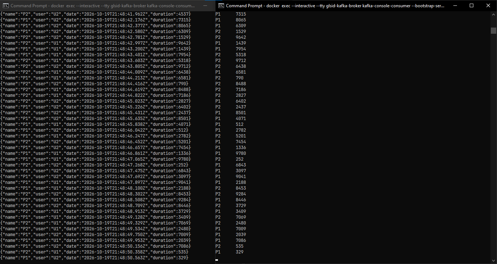 \
On ajoute d'autres opérations dans la fonction `kStreamFunction` de `PageEventHandler` :
```java
@Bean
public Function<KStream<String, PageEvent>, KStream<String, Long>> kStreamFunction() {
    return (input) ->
            input.filter((k,v)->v.duration()>100)
                    .map((k,v)->new KeyValue<>(v.name(), v.duration()))
                    .groupByKey(Grouped.with(Serdes.String(), Serdes.Long()))
                    .count()
                    .toStream();

    // the filter keeps only the events with duration > 100
    // mapping: the old key-value becomes a new key-value where the key is the name of the PageEvent and the value is its duration
    // groupBy: groups by name and counts for each name
    // .toStream: returns to a KStream, because map leaves a KStream but groupBy makes it a KTable, so it has to be turned back into a KStream

}
```
On le teste : \
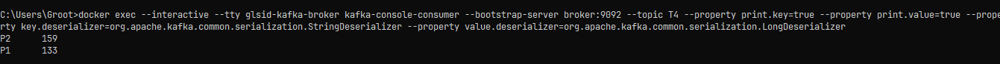 \
Remarque : on attend 30 secondes pour obtenir le résultat, mais on peut modifier ce délai en ajoutant dans `application.properties` :
```properties
spring.cloud.stream.kafka.streams.binder.configuration.commit.interval.ms=5000
```
C'est-à-dire que les calculs se font sur un intervalle de 5 secondes (le count est calculé sur 5 secondes). \
On le teste : \
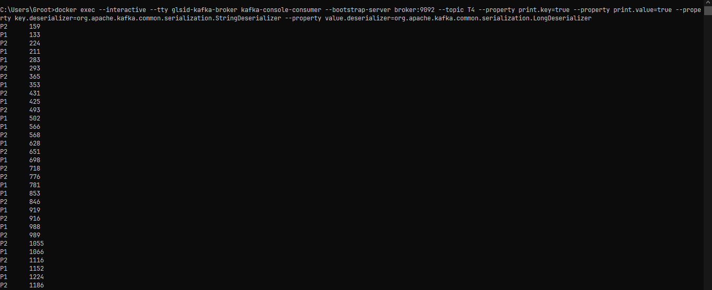 \
On voit que le nombre augmente continuellement. C'est pourquoi on ajoute `windowedBy`, pour obtenir le count des 5 dernières secondes, par exemple, sans accumulation. \
```java
 @Bean
public Function<KStream<String, PageEvent>, KStream<String, Long>> kStreamFunction() {
    return (input) ->
            input.filter((k,v)->v.duration()>100)
                    .map((k,v)->new KeyValue<>(v.name(), v.duration()))
                    .groupByKey(Grouped.with(Serdes.String(), Serdes.Long()))
                    .windowedBy(TimeWindows.ofSizeWithNoGrace(Duration.ofSeconds(5)))
                    .count()
                    .toStream()
                    .map((k, v) -> new KeyValue<>(k.key(), v));

    // the filter keeps only the events with duration > 100
    // mapping: the old key-value becomes a new key-value where the key is the name of the PageEvent and the value is its duration
    // groupBy: groups by name and counts for each name
    // .toStream: returns to a KStream, because map leaves a KStream but groupBy makes it a KTable, so it has to be turned back into a KStream
    // .windowedBy : propriété de fenêtrage pour réinitialiser le calcul toutes les 5 secondes
}
```
On le teste : \
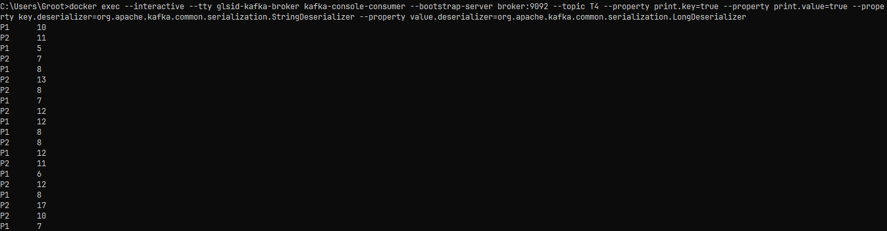 \


[//]: # (note : there is in kafka producer and consumer, in java cloud there is producer and consumer and supplier, supplier is just auto producer 
that send to the topic every 1 second by default, and in spring cloud there is stream [Function...] thats act like consumer and producer after processing the data that consume
in stream we use the long command)

## 8 - Une application web qui affiche en temps réel les résultats du Stream Data Analytics
On modifie la fonction `kStreamFunction` en ajoutant un store `Materialized` :
```java
@Bean
public Function<KStream<String, PageEvent>, KStream<String, Long>> kStreamFunction() {
    return (input) ->
            input.filter((k,v)->v.duration()>100)
                    .map((k,v)->new KeyValue<>(v.name(), v.duration()))
                    .groupByKey(Grouped.with(Serdes.String(), Serdes.Long()))
                    .windowedBy(TimeWindows.ofSizeWithNoGrace(Duration.ofSeconds(5)))
                    .count(Materialized.as("count-store"))
                    .toStream()
                    .map((k, v) -> new KeyValue<>(k.key(), v));
}
```
Et on ajoute la méthode `analytics` dans le contrôleur `PageEventController` :
```java
@Autowired
private InteractiveQueryService interactiveQueryService;
@GetMapping(path = "/analytics",produces = MediaType.TEXT_EVENT_STREAM_VALUE)
public Flux<Map<String, Long>> analytics(){
    return Flux.interval(Duration.ofSeconds(1))
            .map(sequence->{
                Map<String,Long> stringLongMap=new HashMap<>();
                ReadOnlyWindowStore<String, Long> windowStore = interactiveQueryService.getQueryableStore("count-store", QueryableStoreTypes.windowStore());
                Instant now=Instant.now();
                Instant from=now.minusMillis(5000);
                KeyValueIterator<Windowed<String>, Long> fetchAll = windowStore.fetchAll(from, now);
                //WindowStoreIterator<Long> fetchAll = windowStore.fetch(page, from, now);
                while (fetchAll.hasNext()){
                    KeyValue<Windowed<String>, Long> next = fetchAll.next();
                    stringLongMap.put(next.key.key(),next.value);
                }
                return stringLongMap;
            });
}
```
Puis on ajoute une page `index.html` dans le dossier `resources/static` :
```html
<!DOCTYPE html>
<html lang="en">
<head>
    <meta charset="UTF-8">
    <title>Analytics</title>
    <script src="https://cdnjs.cloudflare.com/ajax/libs/smoothie/1.34.0/smoothie.min.js"></script>
</head>
<body>

<canvas id="chart2" width="1400" height="700"></canvas>
<script>
    var index=-1;
    randomColor = function() {
        ++index;
        if (index >= colors.length) index = 0; return colors[index];
    }
    var pages=["P1","P2"];
    var colors=[
        { sroke : 'rgba(0, 255, 0, 1)', fill : 'rgba(0, 255, 0, 0.2)' },
        { sroke : 'rgba(255, 0, 0, 1)', fill : 'rgba(255, 0, 0, 0.2)'}
    ];
    var courbe = [];
    var smoothieChart = new SmoothieChart({tooltip: true});
    smoothieChart.streamTo(document.getElementById("chart2"), 500);
    pages.forEach(function(v){
        courbe[v]=new TimeSeries();
        col = randomColor();
        smoothieChart.addTimeSeries(courbe[v], {strokeStyle : col.sroke, fillStyle : col.fill, lineWidth : 2
        });
    });
    var stockEventSource= new EventSource("/analytics");
    stockEventSource.addEventListener("message", function (event) {
        pages.forEach(function(v){
            val=JSON.parse(event.data)[v];
            courbe[v].append(new Date().getTime(),val);
        });
    });

</script>
</body>
</html>
</body>
</html>
```
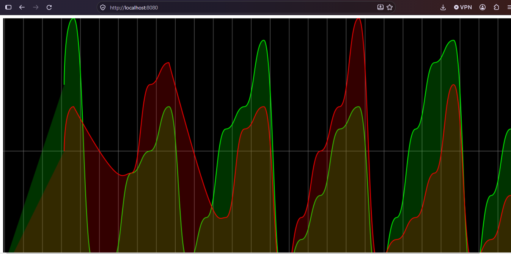 \