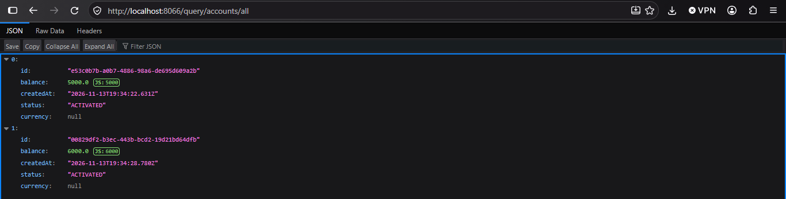
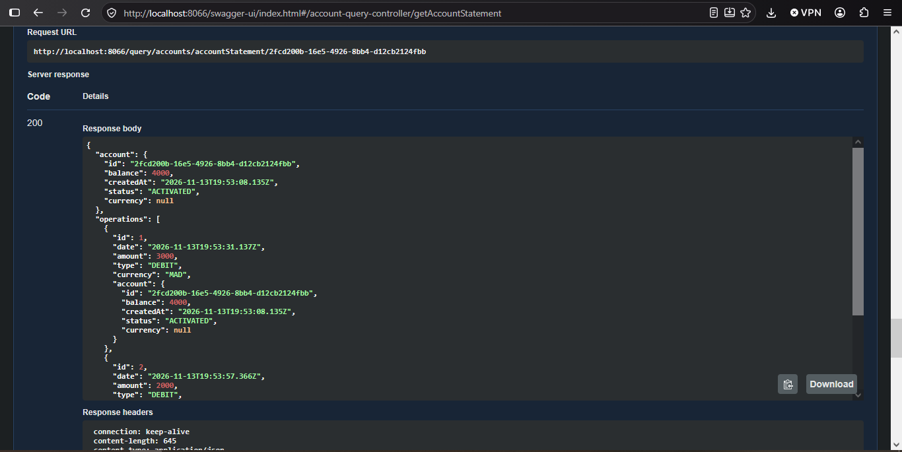
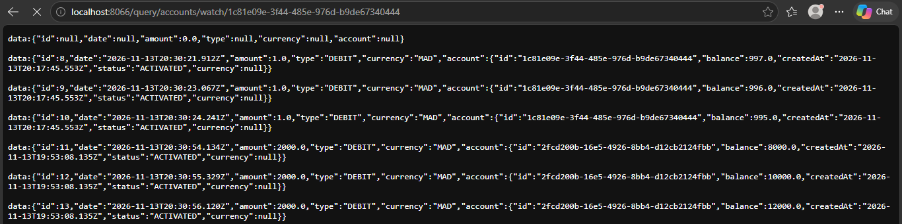
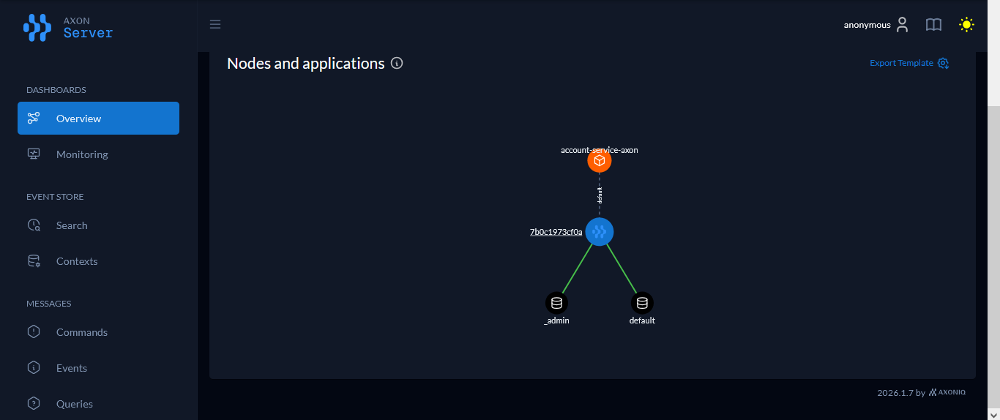
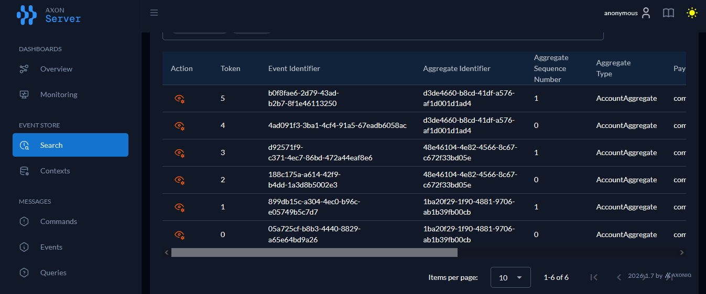

# Rapport de l'Activité Pratique N°4 : CQRS et Event Sourcing avec Axon et Spring Boot

**Référence :** https://www.youtube.com/watch?v=ZxE9mbvu0og \
**Réalisé par :** HAMZA ELCADI - GLSID3

---

## Introduction

Cette activité a pour objectif de mettre en œuvre deux patrons d'architecture avec le framework **Axon** :

- **CQRS** (Command Query Responsibility Segregation) : on sépare le côté **écriture** (commandes qui modifient l'état) du côté **lecture** (requêtes qui consultent l'état).
- **Event Sourcing** : au lieu de stocker l'état courant d'un compte, on stocke la **suite des événements** qui l'ont modifié (création, crédit, débit, etc.). L'état actuel s'obtient en rejouant ces événements.

Nous développons un micro-service de gestion de comptes bancaires qui applique ces deux patrons.

---

## 1 - Création du projet

Nous créons un projet Java nommé `account-service-axon` :


avec les dépendances suivantes :
- **Spring Web**
- **Spring Data JPA**
- **Lombok**
- **H2 Database**
- **PostgreSQL Driver**

Nous modifions la version de `lombok` en la fixant à `1.18.34`, à la fois dans la dépendance et dans la configuration de l'annotation processor :

```xml
<dependency>
    <groupId>org.projectlombok</groupId>
    <artifactId>lombok</artifactId>
    <version>1.18.34</version>
    <optional>true</optional>
</dependency>

<annotationProcessorPaths>
    <path>
        <groupId>org.projectlombok</groupId>
        <artifactId>lombok</artifactId>
        <version>1.18.34</version>
    </path>
</annotationProcessorPaths>
```

Nous ajoutons ensuite la dépendance du framework **Axon**. L'exclusion du module `axon-server-connector` permet de ne pas utiliser Axon Server : Axon utilise alors un event store en mémoire (dans un premier temps) :

```xml
<dependency>
    <groupId>org.axonframework</groupId>
    <artifactId>axon-spring-boot-starter</artifactId>
    <version>4.13.2</version>
    <exclusions>
        <exclusion>
            <groupId>org.axonframework</groupId>
            <artifactId>axon-server-connector</artifactId>
        </exclusion>
    </exclusions>
</dependency>
```

Enfin, nous ajoutons la dépendance qui génère la documentation de l'API (Swagger UI) :

```xml
<dependency>
    <groupId>org.springdoc</groupId>
    <artifactId>springdoc-openapi-starter-webmvc-ui</artifactId>
    <version>3.2.0</version>
</dependency>
```

---

## 2 - Développement du côté Commande

Nous créons le package `commands` (côté **écriture**) et, à l'intérieur, le sous-package `controllers` qui contient la classe `AccountCommandController`. Ce contrôleur reçoit les requêtes HTTP et envoie les commandes correspondantes via le `CommandGateway` d'Axon :

```java
@RestController
@RequestMapping("/commands/accounts")
@AllArgsConstructor
public class AccountCommandController {
    private CommandGateway commandGateway;

    @PostMapping("/add")
    public CompletableFuture<String> addNewAccount(@RequestBody AddNewAccountRequestDto requestDto) {
        // Envoi (dispatch) de la commande. Le type retourné est <String>
        // car l'identifiant de l'agrégat est de type String.
        CompletableFuture<String> response = commandGateway.send(new AddAccountCommand(
                UUID.randomUUID().toString(),
                requestDto.initialBalance(),
                requestDto.currency()
        ));
        return response;
    }

    @ExceptionHandler(Exception.class)
    public String exceptionHandler(Exception exception) {
        return exception.getMessage();
    }
}
```

Dans un sous-package `dto`, nous créons la classe `AddNewAccountRequestDto` :

```java
public record AddNewAccountRequestDto(double initialBalance, String currency) {
}
```

Dans un sous-package `commands`, nous créons la commande `AddAccountCommand`. L'annotation `@TargetAggregateIdentifier` indique à Axon quel attribut identifie l'agrégat visé par la commande :

```java
@Getter @AllArgsConstructor
public class AddAccountCommand {
    @TargetAggregateIdentifier
    private String id;
    private double initialBalance;
    private String currency;
}
```

Dans `application.properties`, nous configurons le nom et le port de l'application :

```properties
spring.application.name=account-service-axon
server.port=8066
```

Voici la documentation Swagger générée :


Si nous testons l'ajout d'un compte à ce stade, nous obtenons l'erreur `No handler was subscribed for command commands.commands.AddAccountCommand`. Elle est normale : aucune classe ne traite encore cette commande. Nous la traiterons dans l'agrégat à l'étape suivante.


---

## 3 - Implémentation des événements

### 3.1 - Création de l'agrégat

Nous créons le package `commands.aggregates` et la classe `AccountAggregate`. L'agrégat contient :
- les **règles métier** : les méthodes annotées `@CommandHandler` décident si une commande est valide ;
- les **mises à jour d'état** : les méthodes annotées `@EventSourcingHandler` modifient l'état de l'agrégat à partir d'un événement.

```java
@Aggregate
@Slf4j
public class AccountAggregate {
    @AggregateIdentifier
    private String accountId;
    private double balance;
    private AccountStatus status;

    // Constructeur sans argument, obligatoire pour Axon
    public AccountAggregate() {}

    // Règles métier (fonction de décision)
    @CommandHandler
    public AccountAggregate(AddAccountCommand command) {
        log.info("##################### AddAccountCommand received ############################");
        if (command.getInitialBalance() <= 0) throw new IllegalArgumentException("Balance must be positive");
        // Si les règles métier sont satisfaites, on publie l'événement
        AggregateLifecycle.apply(new AccountCreatedEvent(
                command.getId(),
                command.getInitialBalance(),
                AccountStatus.CREATED,
                command.getCurrency()
        ));
    }

    // Mise à jour de l'état à partir de l'événement
    @EventSourcingHandler
    public void on(AccountCreatedEvent event) {
        log.info("##################### AccountCreatedEvent occurred ############################");
        this.accountId = event.getAccountId();
        this.balance = event.getInitialBalance();
        this.status = event.getStatus();
    }
}
```

> **Note :** l'annotation `@AggregateIdentifier` sur `accountId` permet à Axon d'identifier l'agrégat lors du chargement de ses événements.

Nous créons l'énumération `enums.AccountStatus` :

```java
public enum AccountStatus {
    CREATED, SUSPENDED, ACTIVATED, BLOCKED
}
```

Puis, dans le package `events`, la classe `AccountCreatedEvent` :

```java
@Getter @AllArgsConstructor
public class AccountCreatedEvent {
    private String accountId;
    private double initialBalance;
    private AccountStatus status;
    private String currency;
}
```

Test de l'ajout d'un compte :


### 3.2 - Consultation des événements dans la console H2

Pour que Hibernate crée automatiquement les tables, nous ajoutons dans `application.properties` :

```properties
spring.jpa.hibernate.ddl-auto=update
```

Nous activons ensuite la console H2 :

```properties
spring.datasource.url=jdbc:h2:mem:accounts-db
spring.h2.console.enabled=true
```


Nous configurons enfin la sérialisation des événements et des messages :

```properties
axon.serializer.events=jackson
axon.serializer.messages=xstream
axon.serializer.general=jackson
```

---

## 4 - Persistance avec PostgreSQL et Docker Compose

Jusqu'ici, les données sont stockées en mémoire et disparaissent à chaque redémarrage. Nous démarrons donc PostgreSQL avec Docker. Nous créons un fichier `compose.yaml` qui définit deux services : PostgreSQL et pgAdmin (interface d'administration).

```yaml
services:
  postgres:
    image: 'postgres:latest'
    environment:
      - 'POSTGRES_DB=accounts_db'
      - 'POSTGRES_PASSWORD=1234'
      - 'POSTGRES_USER=admin'
    volumes:
      - accounts_data:/var/lib/postgresql/data
    ports:
      - '5432:5432'
    networks:
      - accounts-net
  pgadmin4:
    image: dpage/pgadmin4
    restart: always
    ports:
      - "8088:80"
    environment:
      PGADMIN_DEFAULT_EMAIL: hamza@gmail.com
      PGADMIN_DEFAULT_PASSWORD: azer
    volumes:
      - accounts_pgadmin_data:/var/lib/pgadmin
    networks:
      - accounts-net
volumes:
  accounts_data:
  accounts_pgadmin_data:

networks:
  accounts-net:
    driver: bridge
```

Nous lançons ensuite les conteneurs :

```shell
docker compose up
```


Nous modifions les propriétés de l'application pour utiliser PostgreSQL :

```properties
spring.jpa.properties.hibernate.dialect=org.hibernate.dialect.PostgreSQLDialect
spring.jpa.hibernate.ddl-auto=create
spring.jpa.show-sql=true
spring.datasource.url=${DB_URL:jdbc:postgresql://localhost:5432/accounts_db}
spring.datasource.username=admin
spring.datasource.password=1234
```

> **Attention :** `ddl-auto=create` supprime et recrée les tables à chaque démarrage. Pour conserver les événements entre deux exécutions, il faut utiliser `update`.

Nous nous connectons à la base de données :


Nous testons en ajoutant un compte :


Nous ajoutons la méthode `eventStore` dans `AccountCommandController` pour lire les événements d'un compte. Elle utilise le bean `EventStore` d'Axon, qu'il faut injecter dans le contrôleur :

```java
private EventStore eventStore;

@GetMapping("/events/{accountId}")
public Stream eventStore(@PathVariable String accountId) {
    return eventStore.readEvents(accountId).asStream();
}
```

Test :


> **Note :** nous ajoutons les annotations suivantes sur `AccountCreatedEvent` (le constructeur sans argument est nécessaire à la désérialisation Jackson) :
> ```java
> @Getter @AllArgsConstructor @Builder @NoArgsConstructor
> ```

### 4.1 - Opération de crédit

Nous créons les classes suivantes.

**`CreditAccountCommand`**
```java
@Getter @AllArgsConstructor
public class CreditAccountCommand {
    @TargetAggregateIdentifier
    private String id;
    private double ammount;
    private String currency;
}
```

**`CreditAccountRequestDto`**
```java
public record CreditAccountRequestDto(String accountId, double ammount, String currency) {
}
```

Nous ajoutons l'endpoint dans le contrôleur :

```java
@PostMapping("/credit")
public CompletableFuture<String> creditAccount(@RequestBody CreditAccountRequestDto requestDto) {
    CompletableFuture<String> response = commandGateway.send(new CreditAccountCommand(
            requestDto.accountId(),
            requestDto.ammount(),
            requestDto.currency()
    ));
    return response;
}
```

**`AccountCreditedEvent`**
```java
@Getter @AllArgsConstructor @Builder @NoArgsConstructor
public class AccountCreditedEvent {
    private String accountId;
    private double ammount;
    private String currency;
}
```

**`AccountActivatedEvent`** : un compte nouvellement créé doit être activé avant de pouvoir être crédité. Nous publions donc un second événement juste après la création.
```java
@Getter @AllArgsConstructor @Builder @NoArgsConstructor
public class AccountActivatedEvent {
    private String accountId;
    private AccountStatus status;
}
```

Nous complétons ensuite `AccountAggregate` :

```java
@EventSourcingHandler
public void on(AccountActivatedEvent event) {
    log.info("##################### AccountActivatedEvent occurred ############################");
    this.accountId = event.getAccountId();
    this.status = event.getStatus();
}

@CommandHandler
public AccountAggregate(AddAccountCommand command) {
    log.info("##################### AddAccountCommand received ############################");
    if (command.getInitialBalance() <= 0) throw new IllegalArgumentException("Balance must be positive");
    // Si les règles métier sont satisfaites, on publie les événements
    AggregateLifecycle.apply(new AccountCreatedEvent(
            command.getId(),
            command.getInitialBalance(),
            AccountStatus.CREATED,
            command.getCurrency()
    ));
    AggregateLifecycle.apply(new AccountActivatedEvent(
            command.getId(),
            AccountStatus.ACTIVATED
    ));
}

@CommandHandler
public void handle(CreditAccountCommand command) {
    log.info("##################### CreditAccountCommand received ############################");
    if (!status.equals(AccountStatus.ACTIVATED))
        throw new RuntimeException("The account " + command.getId() + " is not activated");
    if (command.getAmmount() <= 0) throw new IllegalArgumentException("Amount must be positive.");
    AggregateLifecycle.apply(new AccountCreditedEvent(
            command.getId(),
            command.getAmmount(),
            command.getCurrency()
    ));
}

@EventSourcingHandler
public void on(AccountCreditedEvent event) {
    log.info("##################### AccountCreditedEvent occurred ############################");
    this.accountId = event.getAccountId();
    this.balance = this.balance + event.getAmmount();
}
```

Après la création d'un compte :


Deux événements ont été enregistrés (`AccountCreatedEvent` et `AccountActivatedEvent`) :


Test du crédit d'un compte :


### 4.2 - Consultation avec pgAdmin

Nous accédons à pgAdmin :


Nous créons un serveur nommé `accounts-db` :


avec les paramètres suivants :
- **Name :** accounts-db
- **Connection / Host name :** postgres (nom du service Docker, accessible grâce au réseau `accounts-net`)
- **Connection / Maintenance database :** accounts_db
- **Connection / Username :** admin
- **Connection / Password :** 1234


### 4.3 - Opération de débit

Nous ajoutons maintenant le cas du débit.

**`DebitAccountRequestDto`**
```java
public record DebitAccountRequestDto(String accountId, double ammount, String currency) {
}
```

**`DebitAccountCommand`**
```java
@Getter @AllArgsConstructor
public class DebitAccountCommand {
    @TargetAggregateIdentifier
    private String id;
    private double ammount;
    private String currency;
}
```

**Dans `AccountCommandController`**
```java
@PostMapping("/debit")
public CompletableFuture<String> debitAccount(@RequestBody DebitAccountRequestDto requestDto) {
    CompletableFuture<String> response = commandGateway.send(new DebitAccountCommand(
            requestDto.accountId(),
            requestDto.ammount(),
            requestDto.currency()
    ));
    return response;
}
```

**`AccountDebitedEvent`**
```java
@Getter @AllArgsConstructor @Builder @NoArgsConstructor
public class AccountDebitedEvent {
    private String accountId;
    private double ammount;
    private String currency;
}
```

**Dans `AccountAggregate`**
```java
@CommandHandler
public void handle(DebitAccountCommand command) {
    log.info("##################### DebitAccountCommand received ############################");
    if (!status.equals(AccountStatus.ACTIVATED))
        throw new RuntimeException("The account " + command.getId() + " is not activated");
    if (command.getAmmount() <= 0) throw new IllegalArgumentException("Amount must be positive.");
    if (balance < command.getAmmount()) throw new RuntimeException("Insufficient balance");
    AggregateLifecycle.apply(new AccountDebitedEvent(
            command.getId(),
            command.getAmmount(),
            command.getCurrency()
    ));
}

@EventSourcingHandler
public void on(AccountDebitedEvent event) {
    log.info("##################### AccountDebitedEvent occurred ############################");
    this.accountId = event.getAccountId();
    this.balance = this.balance - event.getAmmount();
}
```

Test :


### 4.4 - Changement du statut d'un compte

Nous ajoutons la possibilité de changer le statut d'un compte (par exemple le suspendre ou le bloquer).

**`UpdateAccountRequestDto`**
```java
public record UpdateAccountRequestDto(String accountId, AccountStatus status) {
}
```

**`UpdateAccountCommand`**
```java
@Getter @AllArgsConstructor
public class UpdateAccountCommand {
    @TargetAggregateIdentifier
    private String id;
    private AccountStatus status;
}
```

**Dans `AccountCommandController`**
```java
@PutMapping("/updateStatus")
public CompletableFuture<String> updateStatus(@RequestBody UpdateAccountRequestDto requestDto) {
    CompletableFuture<String> response = commandGateway.send(new UpdateAccountCommand(
            requestDto.accountId(),
            requestDto.status()
    ));
    return response;
}
```

**`AccountStatusUpdatedEvent`**
```java
@Getter @AllArgsConstructor @Builder @NoArgsConstructor
public class AccountStatusUpdatedEvent {
    private String accountId;
    private AccountStatus status;
}
```

**Dans `AccountAggregate`**
```java
@CommandHandler
public void handle(UpdateAccountCommand command) {
    log.info("##################### UpdateAccountCommand received ############################");
    if (command.getStatus() == status)
        throw new RuntimeException("The account is already " + command.getStatus());
    AggregateLifecycle.apply(new AccountStatusUpdatedEvent(
            command.getId(),
            command.getStatus()
    ));
}

@EventSourcingHandler
public void on(AccountStatusUpdatedEvent event) {
    log.info("##################### AccountStatusUpdatedEvent occurred ############################");
    this.accountId = event.getAccountId();
    this.status = event.getStatus();
}
```

Test :


---

## 5 - Développement du côté Lecture

Le côté commande ne stocke que des événements. Pour consulter efficacement l'état des comptes, nous construisons le côté **lecture** : des handlers écoutent les événements et mettent à jour des tables classiques (la « vue » de lecture).

Nous créons le package `query` (côté **lecture**), puis le sous-package `entities`.

**`Account`**
```java
@Entity
@Getter @Setter @NoArgsConstructor @AllArgsConstructor @Builder
public class Account {
    @Id
    private String id;
    private double balance;
    private Instant createdAt;
    @Enumerated(EnumType.STRING)
    private AccountStatus status;
    private String currency;
}
```

**`AccountOperation`**
```java
@Entity
@Getter @Setter @NoArgsConstructor @AllArgsConstructor @Builder
public class AccountOperation {
    @Id @GeneratedValue(strategy = GenerationType.IDENTITY)
    private Long id;
    private Instant date;
    private double amount;
    @Enumerated(EnumType.STRING)
    private OperationType type;
    private String currency;
    @ManyToOne
    private Account account;
}
```

**`OperationType`**
```java
public enum OperationType {
    CREDIT, DEBIT
}
```

Nous créons ensuite le package `repository` :

**`AccountRepository`**
```java
public interface AccountRepository extends JpaRepository<Account, String> {
}
```

**`OperationRepository`**
```java
public interface OperationRepository extends JpaRepository<AccountOperation, Long> {
    List<AccountOperation> findByAccountId(String id);
}
```

### 5.1 - Les gestionnaires d'événements (event handlers)

Nous créons le sous-package `query.handlers` et la classe `AccountEventHandler`. Chaque méthode annotée `@EventHandler` réagit à un type d'événement et met à jour la base de lecture :

```java
@Component
@Slf4j
public class AccountEventHandler {
    private AccountRepository accountRepository;
    private OperationRepository operationRepository;

    public AccountEventHandler(AccountRepository accountRepository, OperationRepository operationRepository) {
        this.accountRepository = accountRepository;
        this.operationRepository = operationRepository;
    }

    @EventHandler
    public void on(AccountCreatedEvent event, EventMessage eventMessage) {
        log.info("Query side AccountCreatedEvent received -------------------------");
        Account account = Account.builder()
                .id(event.getAccountId())
                .balance(event.getInitialBalance())
                .status(event.getStatus())
                .currency(event.getCurrency())
                .createdAt(eventMessage.getTimestamp())
                .build();
        accountRepository.save(account);
    }
}
```

Test :


Nous ajoutons ensuite les handlers des autres événements dans `AccountEventHandler` :

```java
@EventHandler
public void on(AccountActivatedEvent event) {
    log.info("Query side AccountActivatedEvent received -------------------------");
    Account account = accountRepository.findById(event.getAccountId()).get();
    account.setStatus(event.getStatus());
    accountRepository.save(account);
}

@EventHandler
public void on(AccountStatusUpdatedEvent event) {
    log.info("Query side AccountStatusUpdatedEvent received -------------------------");
    Account account = accountRepository.findById(event.getAccountId()).get();
    account.setStatus(event.getStatus());
    accountRepository.save(account);
}

@EventHandler
public void on(AccountDebitedEvent event, EventMessage eventMessage) {
    log.info("Query side AccountDebitedEvent received -------------------------");
    Account account = accountRepository.findById(event.getAccountId()).get();
    AccountOperation accountOperation = AccountOperation.builder()
            .amount(event.getAmmount())
            .date(eventMessage.getTimestamp())
            .type(OperationType.DEBIT)
            .currency(event.getCurrency())
            .account(account)
            .build();
    operationRepository.save(accountOperation);
    account.setBalance(account.getBalance() - accountOperation.getAmount());
    accountRepository.save(account);
}

@EventHandler
public void on(AccountCreditedEvent event, EventMessage eventMessage) {
    log.info("Query side AccountCreditedEvent received -------------------------");
    Account account = accountRepository.findById(event.getAccountId()).get();
    AccountOperation accountOperation = AccountOperation.builder()
            .amount(event.getAmmount())
            .date(eventMessage.getTimestamp())
            .type(OperationType.CREDIT)
            .currency(event.getCurrency())
            .account(account)
            .build();
    operationRepository.save(accountOperation);
    account.setBalance(account.getBalance() + accountOperation.getAmount());
    accountRepository.save(account);
}
```

Test :


### 5.2 - Les requêtes et les contrôleurs du côté lecture

Nous créons le package `query.controllers`, ainsi que les classes de requêtes.

**`GetAllAccountsQuery`**
```java
public class GetAllAccountsQuery {
}
```

**`handlers.AccountQueryHandler`** : la méthode annotée `@QueryHandler` répond à une requête.
```java
@Component
public class AccountQueryHandler {
    private AccountRepository accountRepository;
    private OperationRepository operationRepository;

    public AccountQueryHandler(AccountRepository accountRepository, OperationRepository operationRepository) {
        this.accountRepository = accountRepository;
        this.operationRepository = operationRepository;
    }

    @QueryHandler
    public List<Account> on(GetAllAccountsQuery query) {
        return accountRepository.findAll();
    }
}
```

**`AccountQueryController`** : il envoie les requêtes via le `QueryGateway`.
```java
@RestController
@RequestMapping("/query/accounts")
public class AccountQueryController {
    private QueryGateway queryGateway;

    public AccountQueryController(QueryGateway queryGateway) {
        this.queryGateway = queryGateway;
    }

    @GetMapping("/all")
    public CompletableFuture<List<Account>> getAllAccounts() {
        return queryGateway.query(new GetAllAccountsQuery(),
                ResponseTypes.multipleInstancesOf(Account.class));
    }
}
```

Test :



Nous créons maintenant le relevé de compte (compte et liste de ses opérations).

**`query.dtos.AccountStatementResponseDTO`**
```java
public record AccountStatementResponseDTO(
        Account account, List<AccountOperation> operations
) {
}
```

**`queries.GetAccountStatementQuery`**
```java
@Getter @AllArgsConstructor
public class GetAccountStatementQuery {
    private String accountId;
}
```

**Dans `AccountQueryController`**
```java
@GetMapping("/accountStatement/{accountId}")
public CompletableFuture<AccountStatementResponseDTO> getAccountStatement(@PathVariable String accountId) {
    return queryGateway.query(new GetAccountStatementQuery(accountId),
            ResponseTypes.instanceOf(AccountStatementResponseDTO.class));
}
```

**Dans `AccountQueryHandler`**
```java
@QueryHandler
public AccountStatementResponseDTO on(GetAccountStatementQuery query) {
    Account account = accountRepository.findById(query.getAccountId()).get();
    List<AccountOperation> operations = operationRepository.findByAccountId(query.getAccountId());
    return new AccountStatementResponseDTO(account, operations);
}
```

Test :



---

## 6 - Streaming des événements en temps réel (SSE)

Nous voulons maintenant recevoir les nouvelles opérations d'un compte **en temps réel**, grâce aux *Server-Sent Events* (SSE) et aux *subscription queries* d'Axon.

Nous ajoutons la dépendance Reactor :

```xml
<dependency>
    <groupId>io.projectreactor</groupId>
    <artifactId>reactor-core</artifactId>
    <version>3.7.2</version>
</dependency>
```

**`queries.WatchEventQuery`**
```java
@Getter @AllArgsConstructor
public class WatchEventQuery {
    private String accountId;
}
```

**Dans `AccountQueryController`**, nous ajoutons l'endpoint de streaming. La *subscription query* renvoie d'abord un résultat initial, puis chaque mise à jour au fur et à mesure :

```java
@GetMapping(value = "/watch/{accountId}", produces = MediaType.TEXT_EVENT_STREAM_VALUE)
public Flux<AccountOperation> watch(@PathVariable String accountId) {
    SubscriptionQueryResult<AccountOperation, AccountOperation> result =
            queryGateway.subscriptionQuery(new WatchEventQuery(accountId),
                    ResponseTypes.instanceOf(AccountOperation.class),
                    ResponseTypes.instanceOf(AccountOperation.class));
    return result.initialResult().concatWith(result.updates());
}
```

**Dans `AccountEventHandler`**, nous injectons le `QueryUpdateEmitter` et nous émettons une mise à jour à la fin des handlers `AccountCreditedEvent` et `AccountDebitedEvent`. Le filtre garantit que seuls les abonnés du compte concerné reçoivent l'opération :

```java
private QueryUpdateEmitter queryUpdateEmitter;

// À la fin des handlers de crédit et de débit :
queryUpdateEmitter.emit(WatchEventQuery.class,
        query -> query.getAccountId().equals(event.getAccountId()),
        accountOperation);
```

> N'oubliez pas d'ajouter `QueryUpdateEmitter` au constructeur de `AccountEventHandler`.

**Dans `AccountQueryHandler`**, nous définissons le résultat initial de la requête (une opération vide) :

```java
@QueryHandler
public AccountOperation on(WatchEventQuery query) {
    return AccountOperation.builder().build();
}
```

Test :



---

## 7 - Intégration d'Axon Server

Jusqu'ici, Axon fonctionnait sans serveur dédié. Nous allons maintenant utiliser **Axon Server**, qui centralise le stockage des événements et le routage des commandes et des requêtes.

Nous commentons l'exclusion du connecteur dans le `pom.xml` :

```xml
<dependency>
    <groupId>org.axonframework</groupId>
    <artifactId>axon-spring-boot-starter</artifactId>
    <version>4.13.2</version>
    <!-- <exclusions>
        <exclusion>
            <groupId>org.axonframework</groupId>
            <artifactId>axon-server-connector</artifactId>
        </exclusion>
    </exclusions> -->
</dependency>
```

Nous pouvons ensuite télécharger Axon Server depuis https://www.axoniq.io/download/axon-server-releases, ou l'exécuter avec Docker. Dans ce cas, nous ajoutons le service suivant dans le fichier `compose.yaml` :

```yaml
  axonserver:
    image: 'axoniq/axonserver:latest'
    environment:
      - 'AXONIQ_AXONSERVER_STANDALONE=TRUE'
    ports:
      - '8024:8024'
      - '8124:8124'
```

Puis nous relançons :

```shell
docker compose up
```

Nous accédons au tableau de bord d'Axon Server à l'adresse `localhost:8024` :



