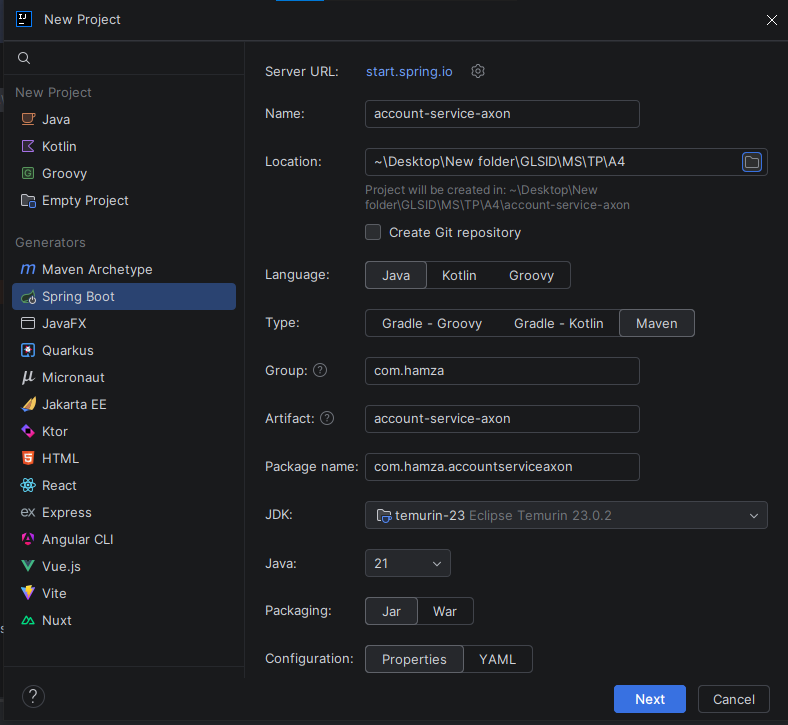
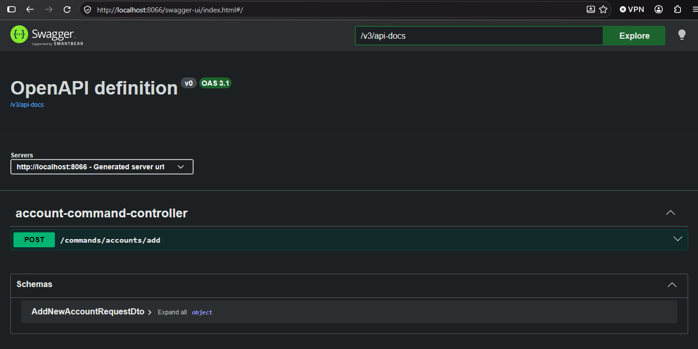
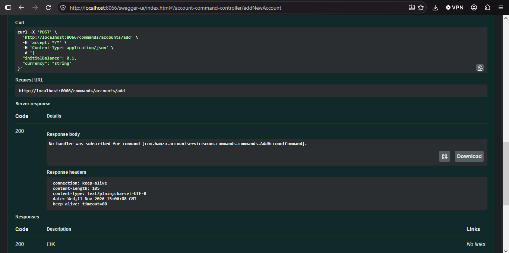
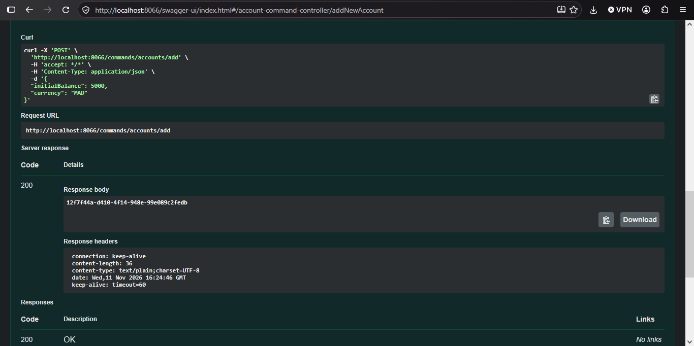
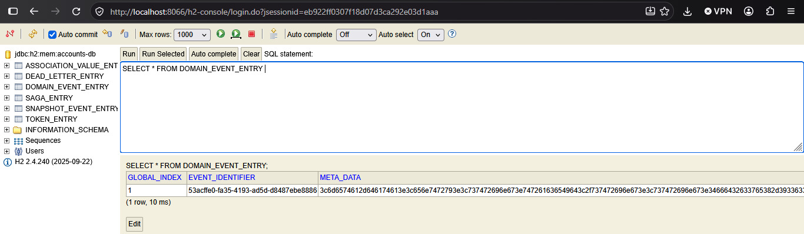
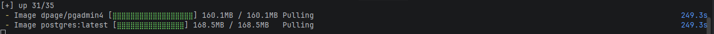

# Rapport de l'Activité Pratique N°4 - CQRS et Event Sourcing avec AXON et Spring Cloud

**Référence :** https://www.youtube.com/watch?v=ZxE9mbvu0og \
**Réalisé par :** HAMZA ELCADI - GLSID3

---

## 1 - Création du projet

On crée un projet Java `account-service-axon` :



Avec les dépendances suivantes :
- **Spring Web**
- **Spring Data JPA**
- **Lombok**
- **H2 Database**
- **PostgresSQL Driver**\
En modifier la version de `lombok` on ajoutons la version
```xml
<dependency>
    <groupId>org.projectlombok</groupId>
    <artifactId>lombok</artifactId>
    <version>1.18.34</version>
    <optional>true</optional>
</dependency>
 <annotationProcessorPaths>
    <path>
        <groupId>org.projectlombok</groupId>
        <artifactId>lombok</artifactId>
        <version>1.18.34</version>
    </path>
</annotationProcessorPaths>
```
on ajoutons la dependances `AXON` framework :
```xml
<dependency>
    <groupId>org.axonframework</groupId>
    <artifactId>axon-spring-boot-starter</artifactId>
    <version>4.13.2</version>
    <exclusions>
        <exclusion>
            <groupId>org.axonframework</groupId>
            <artifactId>axon-server-connector</artifactId>
        </exclusion>
    </exclusions>
</dependency>
```
exclusion donne un serveur au memoire. \
On ajoutons la dependance de documentation
```xml
<dependency>
      <groupId>org.springdoc</groupId>
      <artifactId>springdoc-openapi-starter-webmvc-ui</artifactId>
      <version>3.2.0</version>
</dependency>
```
## 2 - Développements du Côté Commande
On creer le package `commands` (ecrire) et un sous package `controllers`. \
la class `AccountCommandController`
```java
@RestController
@RequestMapping("/commands/accounts")
@AllArgsConstructor
public class AccountCommandController {
    private CommandGateway commandGateway;
    @PostMapping("/add")
    public CompletableFuture<String> addNewAccount(@RequestBody AddNewAccountRequestDto requestDto) {
        //dispatching //<String> car targetAgrregate is a sting
        CompletableFuture<String> response = commandGateway.send(new AddAccountCommand(
                UUID.randomUUID().toString(),
                requestDto.initialBalance(),
                requestDto.currency()
        ));
        return response;
    }
    @ExceptionHandler(Exception.class)
    public String exceptionHandler(Exception exception) {
        return exception.getMessage();
    }

}
```
et une sous package `dto` et la class `AddNewAccountRequestDto`
```java
public record AddNewAccountRequestDto(double initialBalance, String currency) {
}
```
et une sous package `commands` et la class `AddAccountCommand`
```java
@Getter @AllArgsConstructor
public class AddAccountCommand {
    @TargetAggregateIdentifier
    private String id;
    private double initialBalance;
    private String currency;
}
```
et dans `application.properties`
```properties
spring.application.name=account-service-axon
server.port=8066
```
 \
 \

## 3 - Implémentation des Événements
### Creation d'aggrega
on creer la package `commands.aggregates` dans lequel la class `AccountAggregate`
```java
@Aggregate
@Slf4j
public class AccountAggregate {
    private String accountId;
    private double balance;
    private AccountStatus status;

    //pour AXON
    public AccountAggregate(){}

    //les regles metiers / fonction de decision
    @CommandHandler
    public AccountAggregate(AddAccountCommand command){
        log.info("##################### AddAccountCommand recived ############################");
        if(command.getInitialBalance()<=0) throw new IllegalArgumentException("Balance must be positive");
        //si les regeles metiers sont satisfaite on lance et dipatch les evenment
        AggregateLifecycle.apply(new AccountCreatedEvent(
                command.getId(),
                command.getInitialBalance(),
                AccountStatus.CREATED,
                command.getCurrency()
        ));
    }

    @EventSourcingHandler
    public void on(AccountCreatedEvent event){
        log.info("##################### AccountCreatedEvent occured ############################");
        this.accountId = event.getAccountId();
        this.balance = event.getInitialBalance();
        this.status = event.getStatus();
    }
}
```
Note creeer la class `enums.AccountStatus`
```java
public enum AccountStatus {
    CREATED, SUSPENDED, ACTIVATED, BLOCKED
}
```
et une package `events` la class `AccountCreatedEvent`
```java
@Getter @AllArgsConstructor
public class AccountCreatedEvent {
    private String accountId;
    private double initialBalance;
    private AccountStatus status;
    private String currency;
}
```
 \
NOTE : ajouter dans `application.properties` \
```properties
spring.jpa.hibernate.ddl-auto=update
```
On enable H2 console dans `application.properties`
```properties
spring.datasource.url=jdbc:h2:mem:accounts-db
spring.h2.console.enabled=true
```
 \
on ajoutons les proprietes suivants
```properties
axon.serializer.events=jackson
axon.serializer.messages=xstream
axon.serializer.general=jackson
```


## 4 - Persistance avec PostgreSQL et Docker Compose
on demarer postgress utilisant docker \
on creer un fichier `composer.yaml`
```yaml
services:
  postgres:
    image: 'postgres:latest'
    environment:
      - 'POSTGRES_DB=accounts_db'
      - 'POSTGRES_PASSWORD=1234'
      - 'POSTGRES_USER=admin'
    volumes:
      - accounts_data:/var/lib/postgresql
    ports:
      - '5432:5432'
    networks:
      - accounts-net
  pgadmin4:
    image: dpage/pgadmin4
    restart: always
    ports:
      - "8088:80"
    environment:
      PGADMIN_DEFAULT_EMAIL: hamza@gmail.com
      PGADMIN_DEFAULT_PASSWORD: azer
    volumes:
      - accounts_pgadmin_data:/var/lib/pgadmin
    networks:
      - accounts-net
volumes:
  accounts_data:
  accounts_pgadmin_data:

networks:
  accounts-net:
    driver: bridge
```
puis run la commande 
```shell
docker compose up
```
 \

puis on ajoutons les proprietes suivants :
```properties
spring.jpa.properties.hibernate.dialect = org.hibernate.dialect.PostgreSQLDialect
spring.jpa.hibernate.ddl-auto=create
spring.jpa.hibernate.show-sql=true
spring.datasource.url= ${DB_URL:jdbc:postgresql://localhost:5432/accounts_db}
spring.datasource.username=admin
spring.datasource.password=1234
```

## 5 - Développements du Côté Lecture
On creer le package `query` (ecriture)

## 6 - Streaming des événements en temps réel (SSE)

## 7 - Intégration d'Axon Server
