# Rapport de l'Activité Pratique N°4 - CQRS et Event Sourcing avec AXON et Spring Cloud

**Référence :** https://www.youtube.com/watch?v=ZxE9mbvu0og \
**Réalisé par :** HAMZA ELCADI - GLSID3

---

## 1 - Création du projet

On crée un projet Java `account-service-axon` :


Avec les dépendances suivantes :
- **Spring Web**
- **Spring Data JPA**
- **Lombok**
- **H2 Database**
- **PostgresSQL Driver**\
En modifier la version de `lombok` on ajoutons la version
```xml
<dependency>
    <groupId>org.projectlombok</groupId>
    <artifactId>lombok</artifactId>
    <version>1.18.34</version>
    <optional>true</optional>
</dependency>
 <annotationProcessorPaths>
    <path>
        <groupId>org.projectlombok</groupId>
        <artifactId>lombok</artifactId>
        <version>1.18.34</version>
    </path>
</annotationProcessorPaths>
```
on ajoutons la dependances `AXON` framework :
```xml
<dependency>
    <groupId>org.axonframework</groupId>
    <artifactId>axon-spring-boot-starter</artifactId>
    <version>4.13.2</version>
    <exclusions>
        <exclusion>
            <groupId>org.axonframework</groupId>
            <artifactId>axon-server-connector</artifactId>
        </exclusion>
    </exclusions>
</dependency>
```
exclusion donne un serveur au memoire. \
On ajoutons la dependance de documentation
```xml
<dependency>
      <groupId>org.springdoc</groupId>
      <artifactId>springdoc-openapi-starter-webmvc-ui</artifactId>
      <version>3.2.0</version>
</dependency>
```
## 2 - Développements du Côté Commande
On creer le package `commands` (ecrire) et un sous package `controllers`. \
la class `AccountCommandController`
```java
@RestController
@RequestMapping("/commands/accounts")
@AllArgsConstructor
public class AccountCommandController {
    private CommandGateway commandGateway;
    @PostMapping("/add")
    public CompletableFuture<String> addNewAccount(@RequestBody AddNewAccountRequestDto requestDto) {
        //dispatching //<String> car targetAgrregate is a sting
        CompletableFuture<String> response = commandGateway.send(new AddAccountCommand(
                UUID.randomUUID().toString(),
                requestDto.initialBalance(),
                requestDto.currency()
        ));
        return response;
    }
    @ExceptionHandler(Exception.class)
    public String exceptionHandler(Exception exception) {
        return exception.getMessage();
    }

}
```
et une sous package `dto` et la class `AddNewAccountRequestDto`
```java
public record AddNewAccountRequestDto(double initialBalance, String currency) {
}
```
et une sous package `commands` et la class `AddAccountCommand`
```java
@Getter @AllArgsConstructor
public class AddAccountCommand {
    @TargetAggregateIdentifier
    private String id;
    private double initialBalance;
    private String currency;
}
```
et dans `application.properties`
```properties
spring.application.name=account-service-axon
server.port=8066
```
 \
 \

## 3 - Implémentation des Événements
### Creation d'aggrega
on creer la package `commands.aggregates` dans lequel la class `AccountAggregate`
```java
@Aggregate
@Slf4j
public class AccountAggregate {
    private String accountId;
    private double balance;
    private AccountStatus status;

    //pour AXON
    public AccountAggregate(){}

    //les regles metiers / fonction de decision
    @CommandHandler
    public AccountAggregate(AddAccountCommand command){
        log.info("##################### AddAccountCommand recived ############################");
        if(command.getInitialBalance()<=0) throw new IllegalArgumentException("Balance must be positive");
        //si les regeles metiers sont satisfaite on lance et dipatch les evenment
        AggregateLifecycle.apply(new AccountCreatedEvent(
                command.getId(),
                command.getInitialBalance(),
                AccountStatus.CREATED,
                command.getCurrency()
        ));
    }

    @EventSourcingHandler
    public void on(AccountCreatedEvent event){
        log.info("##################### AccountCreatedEvent occured ############################");
        this.accountId = event.getAccountId();
        this.balance = event.getInitialBalance();
        this.status = event.getStatus();
    }
}
```
Note creeer la class `enums.AccountStatus`
```java
public enum AccountStatus {
    CREATED, SUSPENDED, ACTIVATED, BLOCKED
}
```
et une package `events` la class `AccountCreatedEvent`
```java
@Getter @AllArgsConstructor
public class AccountCreatedEvent {
    private String accountId;
    private double initialBalance;
    private AccountStatus status;
    private String currency;
}
```
 \
NOTE : ajouter dans `application.properties` \
```properties
spring.jpa.hibernate.ddl-auto=update
```
On enable H2 console dans `application.properties`
```properties
spring.datasource.url=jdbc:h2:mem:accounts-db
spring.h2.console.enabled=true
```
 \
on ajoutons les proprietes suivants
```properties
axon.serializer.events=jackson
axon.serializer.messages=xstream
axon.serializer.general=jackson
```


## 4 - Persistance avec PostgreSQL et Docker Compose
on demarer postgress utilisant docker \
on creer un fichier `composer.yaml`
```yaml
services:
  postgres:
    image: 'postgres:latest'
    environment:
      - 'POSTGRES_DB=accounts_db'
      - 'POSTGRES_PASSWORD=1234'
      - 'POSTGRES_USER=admin'
    volumes:
      - accounts_data:/var/lib/postgresql
    ports:
      - '5432:5432'
    networks:
      - accounts-net
  pgadmin4:
    image: dpage/pgadmin4
    restart: always
    ports:
      - "8088:80"
    environment:
      PGADMIN_DEFAULT_EMAIL: hamza@gmail.com
      PGADMIN_DEFAULT_PASSWORD: azer
    volumes:
      - accounts_pgadmin_data:/var/lib/pgadmin
    networks:
      - accounts-net
volumes:
  accounts_data:
  accounts_pgadmin_data:

networks:
  accounts-net:
    driver: bridge
```
puis run la commande 
```shell
docker compose up
```
 \

puis on ajoutons les proprietes suivants :
```properties
spring.jpa.properties.hibernate.dialect = org.hibernate.dialect.PostgreSQLDialect
spring.jpa.hibernate.ddl-auto=create
spring.jpa.hibernate.show-sql=true
spring.datasource.url= ${DB_URL:jdbc:postgresql://localhost:5432/accounts_db}
spring.datasource.username=admin
spring.datasource.password=1234
```
et on faire la connection
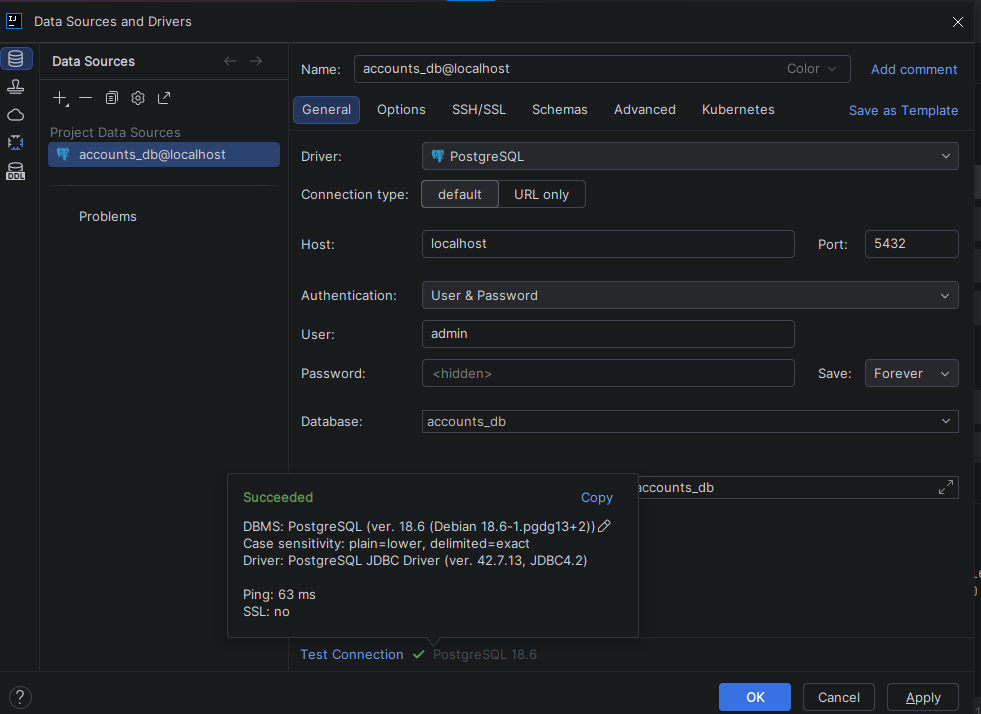 \
et on le test on ajoutons une account
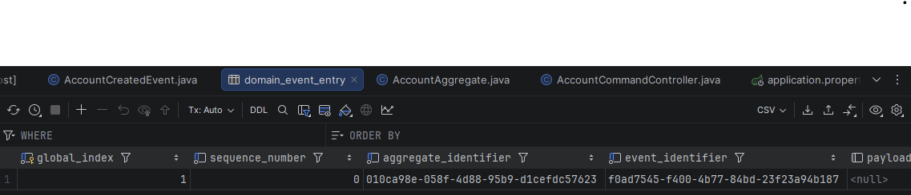 \
on ajoutons la methode `eventStore` dans `AccountCommandController`
```java
@GetMapping("/events/{accountId}")
public Stream eventStore(@PathVariable String accountId){
    return eventStore.readEvents(accountId).asStream();
}
```
on le test
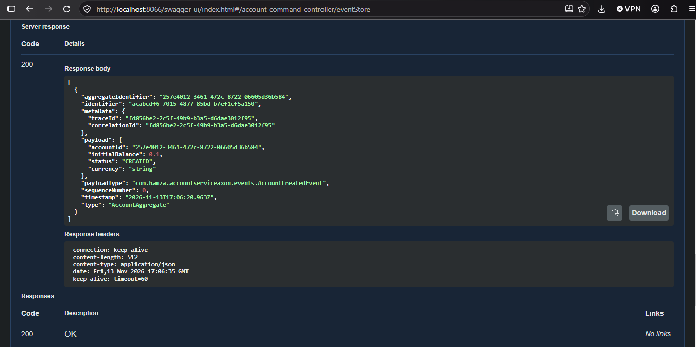 \
Note : add `AccountCreatedEvent`
```java
@Getter @AllArgsConstructor @Builder @NoArgsConstructor
```
on creer les class
- `CreditAccountCommand`
```java
@Getter @AllArgsConstructor
public class CreditAccountCommand {
    @TargetAggregateIdentifier
    private String id;
    private double ammount;
    private String currency;
}
```
- CreditAccountRequestDto
```java
public record CreditAccountRequestDto(String accountId,double ammount, String currency) {
}
```
et on update le controller 
```java
@PostMapping("/credit")
public CompletableFuture<String> creditAccount(@RequestBody CreditAccountRequestDto requestDto) {
    //dispatching //<String> car targetAgrregate is a sting
    CompletableFuture<String> response = commandGateway.send(new CreditAccountCommand(
            requestDto.accountId(),
            requestDto.ammount(),
            requestDto.currency()
    ));
    return response;
}
```
- `AccountCreditedEvent`
```java
@Getter @AllArgsConstructor @Builder @NoArgsConstructor
public class AccountCreditedEvent {
    private String accountId;
    private double ammount;
    private String currency;
}
```
- `AccountActivatedEvent`
```java
@Getter @AllArgsConstructor @Builder @NoArgsConstructor
public class AccountActivatedEvent {
    private String accountId;
    private AccountStatus status;
}
```
puis dans `AccountAggregate`

```java
@EventSourcingHandler
public void on(AccountActivatedEvent event){
    log.info("##################### AccountActivated occured ############################");
    this.accountId = event.getAccountId();
    this.status = event.getStatus();
}
@CommandHandler
public AccountAggregate(AddAccountCommand command){
    log.info("##################### AddAccountCommand recived ############################");
    if(command.getInitialBalance()<=0) throw new IllegalArgumentException("Balance must be positive");
    //si les regeles metiers sont satisfaite on lance et dipatch les evenment
    AggregateLifecycle.apply(new AccountCreatedEvent(
            command.getId(),
            command.getInitialBalance(),
            AccountStatus.CREATED,
            command.getCurrency()
    ));
    AggregateLifecycle.apply(new AccountActivatedEvent(
            command.getId(),
            AccountStatus.ACTIVATED
    ));
}
@CommandHandler
public void handle(CreditAccountCommand command){
    log.info("##################### CreditAccountCommand recived ############################");
    if(!status.equals(AccountStatus.ACTIVATED)) throw  new RuntimeException("The account" + command.getId() + " is not activated");
    if(command.getAmmount()<=0) throw  new IllegalArgumentException("Ammount must be positive.");
    //si les regeles metiers sont satisfaite on lance et dipatch les evenment
    AggregateLifecycle.apply(new AccountCreditedEvent(
            command.getId(),
            command.getAmmount(),
            command.getCurrency()
    ));
}
@EventSourcingHandler
public void on(AccountCreditedEvent event){
    log.info("##################### AccountCreditedEvent occured ############################");
    this.accountId = event.getAccountId();
    this.balance = this.balance + event.getAmmount();
}
```
apres la creation de account
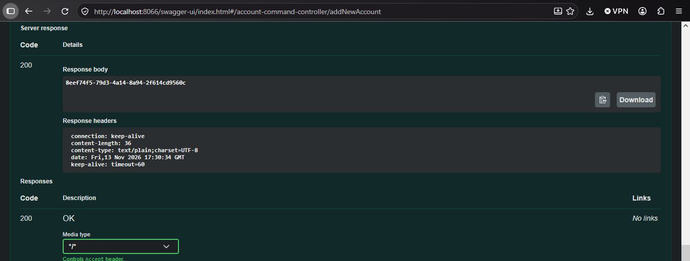 \
il ya deux evenement a ete created
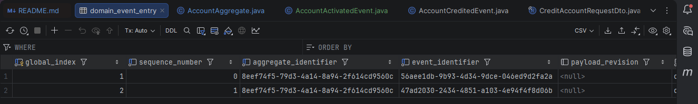 \
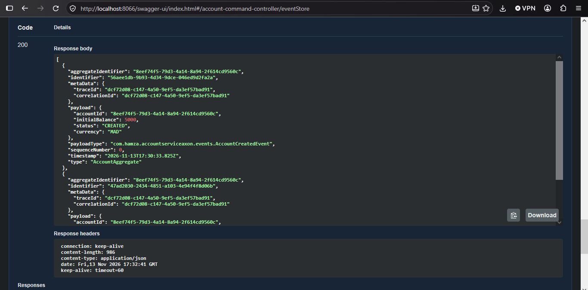 \
en tester account credit
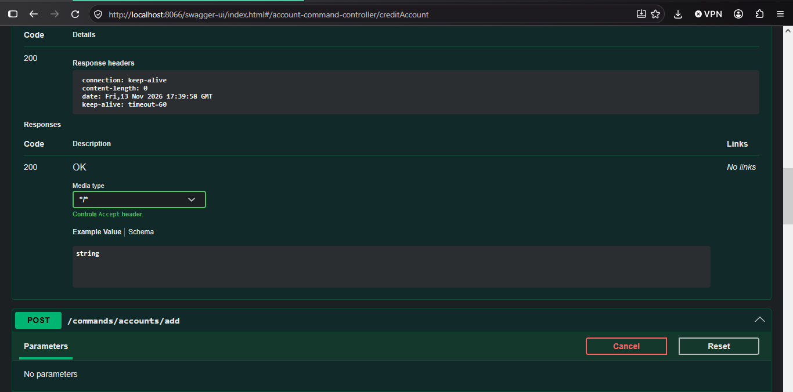 \

en entrer pgADMIN
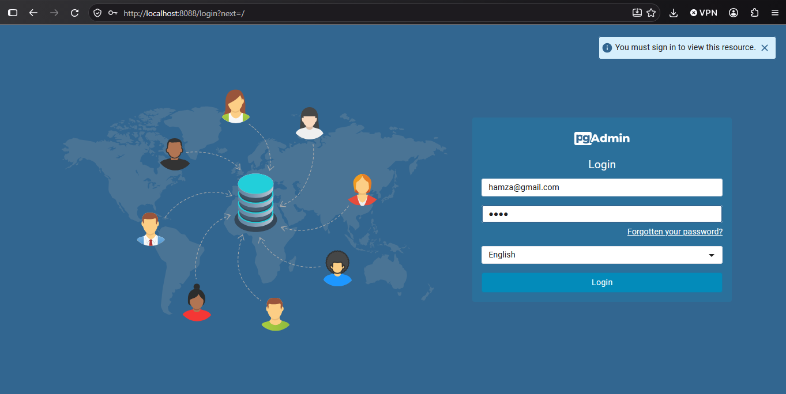 \
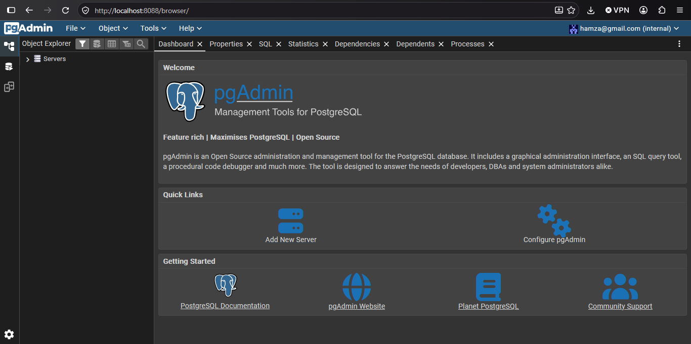 \
on creer un serveur `accounts-db`
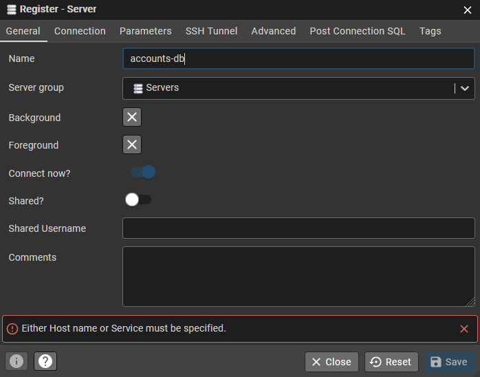 \
avec le parametere
- name : accounts-db
- connection / host name : postgres
- connection / maintenance : accounts_db
- connection / username : admin
- connection / password : 1234
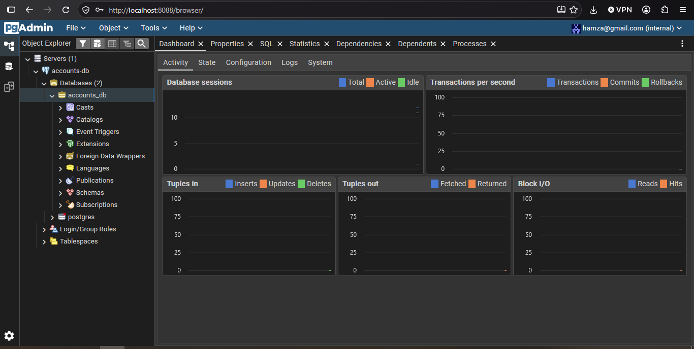 \
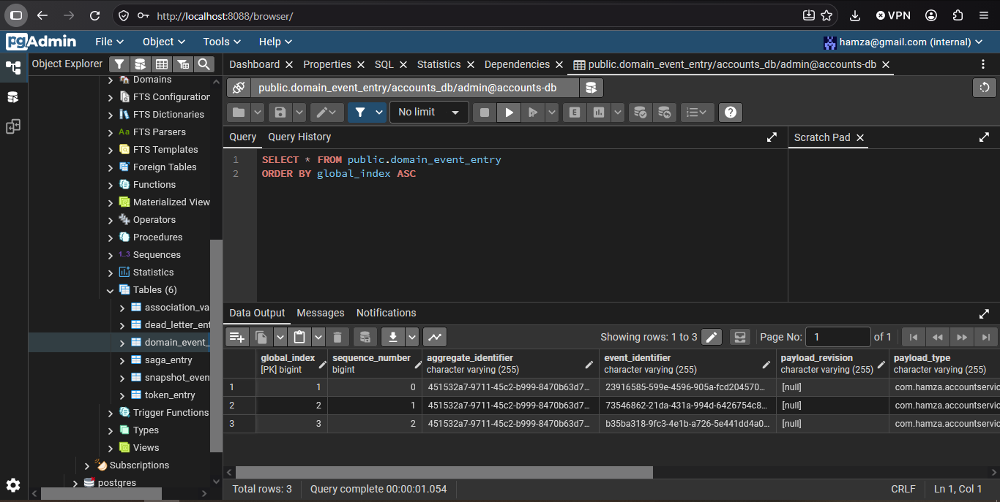 \

on ajoutons le cas de `debit`
- DebitAccountRequestDto
```java
public record DebitAccountRequestDto(String accountId, double ammount, String currency) {
}
```
- `DebitAccountCommand`
```java
@Getter @AllArgsConstructor
public class DebitAccountCommand {
    @TargetAggregateIdentifier
    private String id;
    private double ammount;
    private String currency;
}
```
- dans `AccountCommandController`
```java
@PostMapping("/debit")
public CompletableFuture<String> debitAccount(@RequestBody DebitAccountRequestDto requestDto) {
    //dispatching //<String> car targetAgrregate is a sting
    CompletableFuture<String> response = commandGateway.send(new DebitAccountCommand(
            requestDto.accountId(),
            requestDto.ammount(),
            requestDto.currency()
    ));
    return response;
}
```
- `AccountDebitedEvent`
```java
@Getter @AllArgsConstructor @Builder @NoArgsConstructor
public class AccountDebitedEvent {
    private String accountId;
    private double ammount;
    private String currency;
}

```
- dans `AccountAggregate`
```java
@CommandHandler
public void handle(DebitAccountCommand command){
    log.info("##################### DebitAccountCommand recived ############################");
    if(!status.equals(AccountStatus.ACTIVATED)) throw  new RuntimeException("The account " + command.getId() + " is not activated");
    if(balance<command.getAmmount()) throw  new RuntimeException("balance not enought exception");
    if(command.getAmmount()<=0) throw  new IllegalArgumentException("Ammount must be positive.");
    AggregateLifecycle.apply(new AccountDebitedEvent(
            command.getId(),
            command.getAmmount(),
            command.getCurrency()
    ));
}
@EventSourcingHandler
public void on(AccountDebitedEvent event){
    log.info("##################### AccountDebitedEvent occured ############################");
    this.accountId = event.getAccountId();
    this.balance = this.balance - event.getAmmount();
}
```
on le test
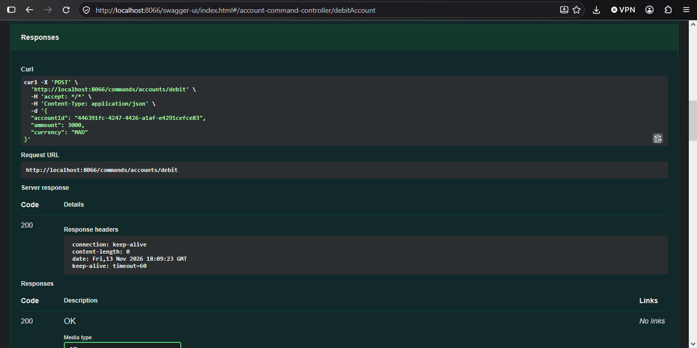 \
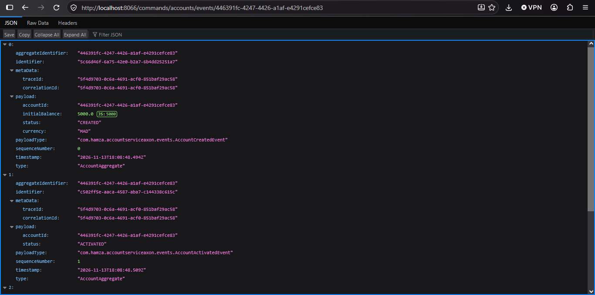 \
On ajoutons la fonction de changement de letat de compte
on creer les class
- UpdateAccountRequestDto
```java
public record UpdateAccountRequestDto(String accountId, AccountStatus status) {
}
```
- UpdateAccountCommand
```java
@Getter @AllArgsConstructor
public class UpdateAccountCommand {
    @TargetAggregateIdentifier
    private String id;
    private AccountStatus status;
}
```
dans controller `AccountCommandController`
```java
@PutMapping("/updateStatus")
public CompletableFuture<String> updateStatus(@RequestBody UpdateAccountRequestDto requestDto) {
    CompletableFuture<String> response = commandGateway.send(new UpdateAccountCommand(
            requestDto.accountId(),
            requestDto.status()
    ));
    return response;
}
```
- `AccountStatusUpdatedEvent`
```java
@Getter @AllArgsConstructor @Builder @NoArgsConstructor
public class AccountStatusUpdatedEvent {
    private String accountId;
    private AccountStatus status;
}
```

dans `AccountAggregate`
```java
@CommandHandler
public void handle(UpdateAccountCommand command){
    log.info("##################### UpdateAccountCommand recived ############################");
    if(command.getStatus() == status) throw  new RuntimeException("The account already " + command.getStatus() );
    AggregateLifecycle.apply(new AccountStatusUpdatedEvent(
            command.getId(),
            command.getStatus()
    ));
}
@EventSourcingHandler
public void on(AccountStatusUpdatedEvent event){
    log.info("##################### AccountStatusUpdatedEvent occured ############################");
    this.accountId = event.getAccountId();
    this.status = event.getStatus();
}
```
on le test
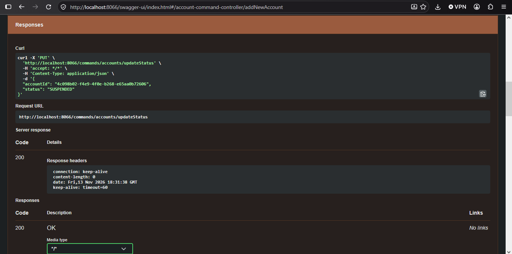 \
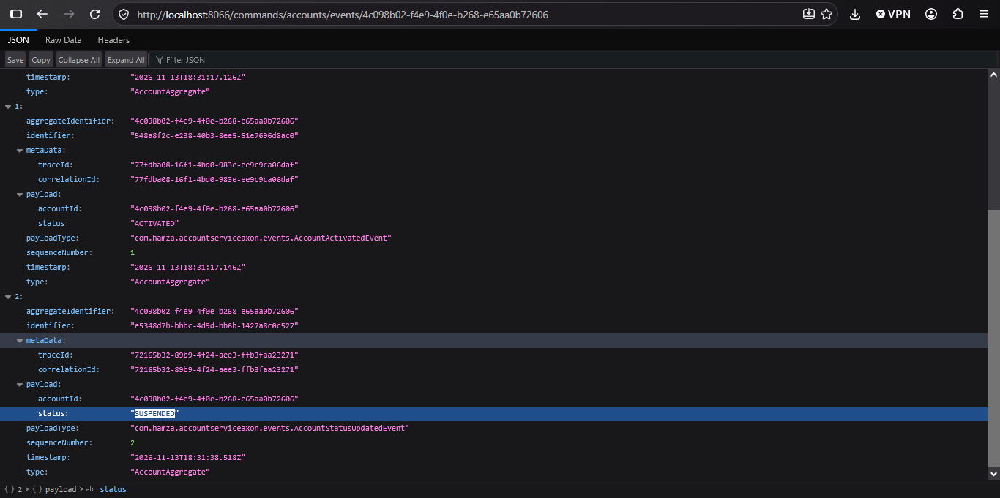 \

## 5 - Développements du Côté Lecture
On creer le package `query` (ecriture)
on creer la sous packages `entities` et la class `Account`
```java
@Entity
@Getter @Setter @NoArgsConstructor @AllArgsConstructor @Builder
public class Account {
    @Id
    private String id;
    private double balance;
    private Instant createdAt;
    @Enumerated(EnumType.STRING)
    private AccountStatus status;
    private String currency;
}
```
- `AccountOperation`
```java
@Entity
@Getter @Setter @NoArgsConstructor @AllArgsConstructor @Builder
public class AccountOperation {
    @Id @GeneratedValue(strategy = GenerationType.IDENTITY)
    private Long id;
    private Instant date;
    private double amount;
    @Enumerated(EnumType.STRING)
    private OperationType type;
    private String currency;
    @ManyToOne
    private Account account;
}
```
- `OperationType`
```java
public enum OperationType {
    CREDIT,DEBIT
}
```
puis package `repository`
- `AccountRepository`
```java
public interface AccountRepository extends JpaRepository<Account,String> {
}
```
- `OperationRepository`

```java
public interface OperationRepository extends JpaRepository<AccountOperation,Long> {
    List<AccountOperation> findByAccountId(String id);
}
```
on creer les `event handlers`
on creer la sous package `query.handlers`
- `AccountEventHandler`
```java
@Component
@Slf4j
public class AccountEventHandler {
    private AccountRepository accountRepository;
    private OperationRepository operationRepository;

    public AccountEventHandler(AccountRepository accountRepository, OperationRepository operationRepository) {
        this.accountRepository = accountRepository;
        this.operationRepository = operationRepository;
    }

    @EventHandler
    public void on(AccountCreatedEvent event, EventMessage eventMessage){
        log.info("Query side accountcreated recieved -------------------------");
        Account account = Account.builder()
                .id(event.getAccountId())
                .balance(event.getInitialBalance())
                .status(event.getStatus())
                .createdAt(eventMessage.getTimestamp())
                .build();
        accountRepository.save(account);
    }
}
```
on le tester
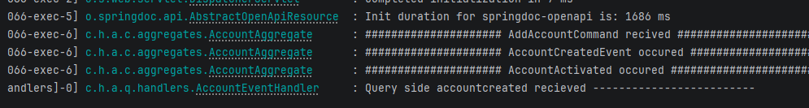 \
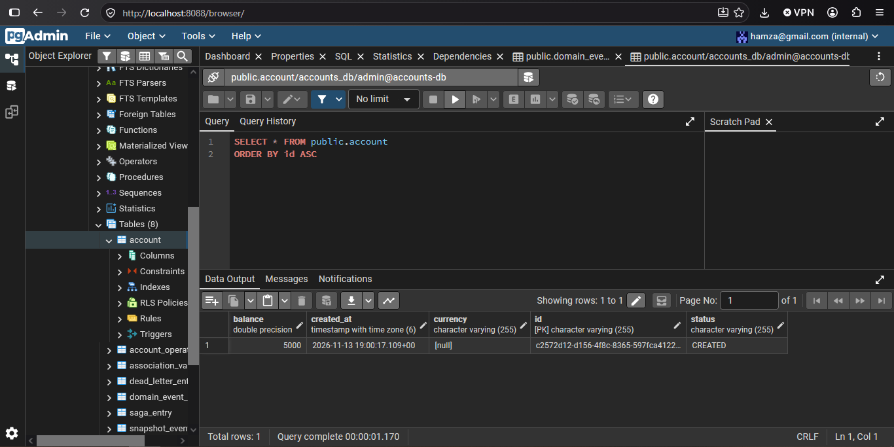 \
on ajoutons dans `AccountEventHandler`
```java
@EventHandler
public void on(AccountActivatedEvent event){
    log.info("Query side AccountActivatedEvent recieved -------------------------");
    Account account = accountRepository.findById(event.getAccountId()).get();
    account.setStatus(event.getStatus());
    accountRepository.save(account);
}

@EventHandler
public void on(AccountStatusUpdatedEvent event){
    log.info("Query side AccountStatusUpdatedEvent recieved -------------------------");
    Account account = accountRepository.findById(event.getAccountId()).get();
    account.setStatus(event.getStatus());
    accountRepository.save(account);
}

@EventHandler
public void on (AccountDebitedEvent event, EventMessage eventMessage){
    log.info("Query side AccountDebitedEvent recieved -------------------------");

    Account account = accountRepository.findById(event.getAccountId()).get();
    AccountOperation accountOperation = AccountOperation.builder()
            .amount(event.getAmmount())
            .date(eventMessage.getTimestamp())
            .type(OperationType.DEBIT)
            .currency(event.getCurrency())
            .account(account)
            .build();
    operationRepository.save(accountOperation);
    account.setBalance(account.getBalance()-accountOperation.getAmount());
    accountRepository.save(account);
}

@EventHandler
public void on (AccountCreditedEvent event, EventMessage eventMessage){
    log.info("Query side AccountCreditedEvent recieved -------------------------");

    Account account = accountRepository.findById(event.getAccountId()).get();
    AccountOperation accountOperation = AccountOperation.builder()
            .amount(event.getAmmount())
            .date(eventMessage.getTimestamp())
            .type(OperationType.DEBIT)
            .currency(event.getCurrency())
            .account(account)
            .build();
    operationRepository.save(accountOperation);
    account.setBalance(account.getBalance()+accountOperation.getAmount());
    accountRepository.save(account);
}
```
on le teste
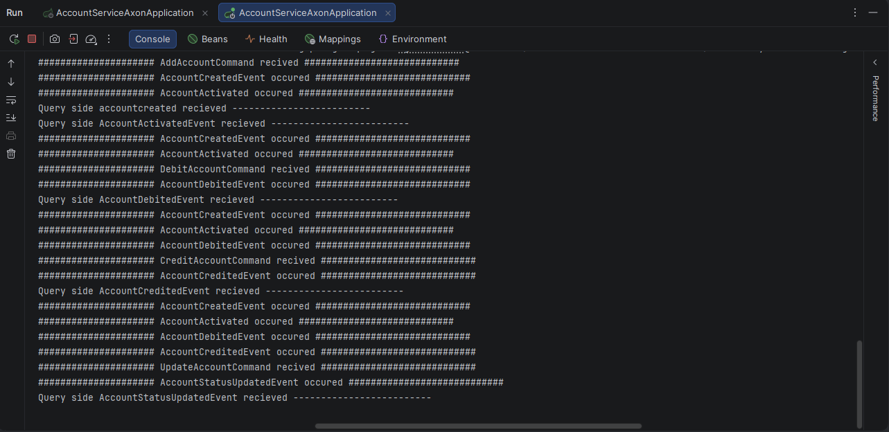 \

## 6 - Streaming des événements en temps réel (SSE)

## 7 - Intégration d'Axon Server
